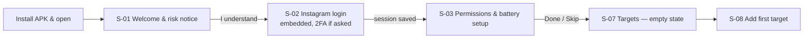

# Storize — UI/UX Design

> Status: **v0.2 — Approved** · Owner: ux-designer · Date: 2026-11-19 · Approved by: user, 2026-11-19 (UQ-1…UQ-3 defaults kept; Reels toggle added at approval)
>
> **Change log v0.2** (follows REQUIREMENTS v0.2):
> - **Posts added:** a Stories/Posts switch in the Library (S-04); a "Kind" filter (S-05); a new **S-15 Post viewer**;
>   Stories/Posts tracking toggles in Add (S-08) and Target detail (S-09); a post check interval and a "New posts" notification in Settings (S-12).
> - **Gallery storage:** the "Save to gallery" action and the "Save location" setting are removed (every file is already in
>   `Pictures/Storize/<username>/`). Delete confirmations now say the file is removed from the gallery too. Settings shows the folder path.
> - Re-rendered mockups: S-04, S-05, S-06, S-08, S-09, S-12, and the new S-15.
> Based on: `docs/01-requirements/REQUIREMENTS.md` v0.1. Its open questions Q-1…Q-10 are still unanswered,
> so this design uses the assumptions A-1…A-16 as defaults. Screens that depend on an assumption say so.
> Mockups: `docs/02-design/mockups/*.png` (one per screen, 360×800 dp, light theme).

**Scope guard:** every screen and control below traces to a requirement ID (FR / NFR / BR / EC).
"Could" items (FR-6 multiple login accounts, FR-36 ZIP export) are marked; FR-6 is **not** designed for the MVP.

---

## 1. User journeys

### J-1 First-time setup (FR-1, FR-2, FR-5, FR-51, A-4)

1. The user opens the app. S-01 explains what Storize does and the risks: the account may be banned,
   and story viewers will see the login account (FR-5, BR-8). It recommends a dedicated account (A-5).
2. The user logs in to Instagram in the embedded page and enters a 2FA code if Instagram asks for one.
   Storize stores only the session (FR-2).
3. S-03 asks for notification permission and walks through battery-optimization exclusion, with steps
   for the phone's manufacturer (FR-51).
4. The user arrives on Targets, which is empty, and is prompted to add the first account.

### J-2 Add a tracked account (FR-10…FR-12, FR-16, BR-1, BR-2, EC-16)
Targets → **+ Add** → enter a username or link → pick a category → (optional) note → **Add & verify**.
→ Storize checks that the account exists, is visible and isn't a duplicate. It then adds the account
and runs the first check right away (FR-21).
Failure paths: not found · private and not followed · already tracked · login session invalid.

### J-3 Passive archiving — the main loop (FR-20, FR-22…FR-25, FR-40, FR-60…FR-66)
Background story check (every 30 min by default) and post check (every 3 h by default) → new items are downloaded straight into
`Pictures/Storize/<username>/` (FR-33) → notification "3 new stories from @name" / "1 new post from @name" → tapping it opens
the Story viewer (S-06) or Post viewer (S-15) on the first new item. The files also show up in the phone's Gallery app as a "Storize" album.

### J-4 Browse and share (FR-30…FR-35)
Library → Stories or Posts → (filter) → tap a story → swipe through that account's stories → **Share** / **Info** / **Delete**.
Tap a post → S-15 → swipe its carousel slides, read the caption → **Share** / **Info** / **Delete**.
Long-press in the Library → selection mode → delete many items.

### J-5 Recover from a session problem (FR-3, FR-4, FR-41, BR-7, EC-1, EC-2)
Notification or red banner "Instagram login needs attention" → S-13 Instagram account →
**Log in again** → S-02 → checking resumes. If the account looks restricted, the screen recommends connecting
a different account (Log out → log in with another).

### J-6 Manage a target (FR-14, FR-15, FR-21, FR-53, FR-36, BR-6)
Targets → tap an account → S-09 Target detail → Pause/Resume · Check now · edit category/note ·
Export ZIP (Could) · Remove → S-10 dialog: keep or delete downloads.

### J-7 Investigate missed stories (FR-52, EC-10, EC-11, EC-14, EC-15)
Activity tab → filter Errors / Gaps → a gap entry "No checks from 02:10 to 09:40" → **Fix battery settings** → S-03.

### J-8 Unlock the app (A-4, NFR-5)
If app lock is on: opening the app → S-14 lock → fingerprint, or PIN as a fallback → the last screen.

---

## 2. Screen inventory

| ID | Screen | Type | Reached from | Requirements |
|----|--------|------|--------------|--------------|
| S-01 | Welcome & risk notice | Onboarding | First launch | FR-5, BR-8, A-5 |
| S-02 | Instagram login | Onboarding / full screen | S-01, S-13, banner | FR-1, FR-2, FR-3 |
| S-03 | Permissions & battery setup | Onboarding / full screen | After S-02, S-11, S-12 gap action | FR-51, FR-40, EC-11 |
| S-04 | Library | Tab (home) | Bottom nav | FR-30, FR-34, FR-35, FR-3 banner |
| S-05 | Library filters | Bottom sheet | S-04 | FR-35 |
| S-06 | Story viewer | Full screen | S-04, S-09, notification | FR-31, FR-32, FR-34, FR-24 |
| S-15 | Post viewer *(v0.2)* | Full screen | S-04 (Posts), S-09, notification | FR-31, FR-32, FR-34, FR-61, FR-62 |
| S-07 | Targets | Tab | Bottom nav | FR-15, FR-21, FR-14 |
| S-08 | Add target | Full screen form | S-07 | FR-10, FR-11, FR-12, FR-16, BR-1, BR-2, EC-16, A-12 |
| S-09 | Target detail | Full screen | S-07 | FR-14, FR-15, FR-16, FR-21, FR-36 (C), FR-53, EC-3…EC-6 |
| S-10 | Remove target | Dialog | S-09 | FR-14, BR-6 |
| S-11 | Activity | Tab | Bottom nav | FR-52, EC-7, EC-10, EC-14, EC-15 |
| S-12 | Settings | Tab | Bottom nav | FR-26, FR-42, FR-50, FR-53, FR-54, A-4 |
| S-13 | Instagram account | Full screen | S-12, banner | FR-4, FR-3, BR-7, EC-1, EC-2 |
| S-14 | App lock | Full screen | App open (if enabled) | A-4, NFR-5 |
| — | System notifications | OS | Background | FR-40, FR-41, FR-42 |

Shared states for all screens are shown in `mockups/S-00-states.png`.

---

## 3. Navigation structure

```
App start
 ├─ (first run) S-01 → S-02 → S-03 → Main
 ├─ (lock on)   S-14 → Main
 └─ Main — bottom navigation (4 tabs, Library is home)
     ├─ Library   S-04 ─┬─ S-05 Filters (sheet)
     │                  ├─ S-06 Story viewer
     │                  └─ S-15 Post viewer
     ├─ Targets   S-07 ─┬─ S-08 Add target
     │                  └─ S-09 Target detail ─┬─ S-06 Story viewer
     │                                         └─ S-10 Remove (dialog)
     ├─ Activity  S-11 ── (gap action) → S-03
     └─ Settings  S-12 ─┬─ S-13 Instagram account ── S-02 Login
                        └─ S-03 Battery setup
Global: Session banner (on S-04, S-07, S-11) → S-13
Deep links: "new stories" notification → S-06 · "new posts" notification → S-15 · "login needed" notification → S-13
```
- Back follows Android's system back gesture. The bottom nav keeps a separate back stack for each tab. Back from the root of Targets, Activity or Settings goes to Library; back from the Library root exits (T-025).
- *Implementation note (T-025, Lead-approved):* S-09 Target detail opens inside the Targets tab, so the bottom bar stays visible. This keeps the per-tab back stack.
- **Why Library is home:** the main ongoing activity is browsing what was saved (G-3). Setup is one-time.

---

## 4. Wireframes & screen specifications

Notation: ASCII wireframes at phone width. `[ ]` = button, `( )` = chip, `▢` = thumbnail, `●` = status dot.

### S-01 Welcome & risk notice
**Purpose:** explain what Storize does and get informed acknowledgement of the risks before login (FR-5, BR-8).
```
┌──────────────────────────────┐
│        [logo] Storize        │
│ Save stories automatically   │
│ before they disappear.       │
│ ─────────────────────────── │
│ ⚠ Before you continue        │
│ • Storize uses an Instagram  │
│   account to view stories.   │
│   Instagram may challenge or │
│   ban that account.          │
│ • People you track will see  │
│   that account as a viewer.  │
│ • Use a dedicated account,   │
│   not your personal one.     │
│ • Only track your own/client │
│   accounts, people who agreed│
│   or public creators.        │
│ ☐ I understand these risks   │
│ [     Continue      ]        │
└──────────────────────────────┘
```
- **Components:** logo, headline, risk card (warning tone), checkbox, primary button.
- **Interactions:** the checkbox enables Continue; Continue → S-02. Shown only on first run, or again after clearing app data.
- **Validation:** Continue is disabled until the checkbox is ticked.
- **States:** no loading or empty state; it's a static screen.

### S-02 Instagram login
**Purpose:** create the login session that Storize uses (FR-1, FR-2).
```
┌──────────────────────────────┐
│ ←  Log in to Instagram       │
│ 🔒 Only the session is saved,│
│    never your password.      │
│ ┌──────────────────────────┐ │
│ │  Instagram's own login   │ │
│ │  page (embedded WebView) │ │
│ │  incl. 2FA / checkpoint  │ │
│ └──────────────────────────┘ │
│ Use a dedicated account ⓘ    │
└──────────────────────────────┘
```
- **Components:** top app bar, info strip, embedded web page, a linear progress bar while the page loads, help link.
- **Interactions:**
  - Storize detects a successful login automatically. It shows "Connected as @name ✓", then → S-03 (first run) or back (re-login).
  - Back during login cancels it.
- **Validation:** Instagram validates the credentials itself. Storize only checks that a valid session cookie exists after login.
  If the logged-in account differs from the previous one during a re-login, ask: *"Switch to @new? Checks will use this account from now on."*
- **Loading:** progress bar while the page loads, then "Connecting…" while the session is verified.
- **Error:**
  - *No internet* → full-screen message with [Retry].
  - *Page failed to load* → [Retry].
  - *Login completed but session not usable* → "Couldn't connect this account. Try again or use another account."
- **Empty:** not applicable.

### S-03 Permissions & battery setup
**Purpose:** make background checks reliable (FR-51, EC-11) and allow notifications (FR-40).
```
┌──────────────────────────────┐
│ Keep Storize running         │
│ Android may stop background  │
│ checks. Two steps fix that.  │
│ ① Notifications      [Allow] │
│   ✓ Allowed                  │
│ ② Battery optimization       │
│   Set Storize to             │
│   "Unrestricted"   [Open]    │
│ ③ Extra step for Samsung     │
│   (detected) ▾ steps…        │
│ [      Done       ]          │
│        Skip for now          │
└──────────────────────────────┘
```
- **Components:** 3 step cards, each with a status (pending / ✓ done), action buttons, expandable manufacturer steps
  (detected from the device; Samsung, Xiaomi, Oppo/Realme, Vivo, Huawei, other).
- **v0.2:** on Android 8–9 only, an extra card "Storage — needed to save into your gallery" appears with [Allow]
  (FR-33). On Android 10+ no storage permission is needed, so the card isn't shown.
- **Interactions:**
  - Allow → system notification permission prompt (Android 13+).
  - Open → system battery settings.
  - Returning to the app re-checks each step's status automatically.
- **Validation:** Done is always enabled. If step ② isn't done, show the inline warning "Checks may be delayed or missed".
- **States:** steps re-check on resume (a short spinner on each card). If the permission is denied twice →
  "Open app settings" link. There's no empty state.

### S-04 Library (home)
**Purpose:** browse every downloaded story and post, newest first, grouped by account and date (FR-30).
```
┌──────────────────────────────┐
│ Library            ⌕  ⚙︎filter│
│ ┌ ⚠ Instagram login needs ─┐ │  ← only when session ≠ active
│ └ attention  [Fix]        ─┘ │
│ [ Stories 12 | Posts 3 ]     │  ← kind switch (v0.2); count = unviewed
│ (All) (@nour) (@brandx) (+3) │  ← account chips
│ Today                        │
│ @nour_k · 3 new              │
│ ▢ ▢ ▢                        │
│ @brandx                      │
│ ▢ ▢ ▢ ▢ ▢ ▢                  │
│ Yesterday                    │
│ ▢ ▢ ▢                        │
│──────────────────────────────│
│ Library Targets Activity Set │
└──────────────────────────────┘
```
- **Components:** top app bar (search by account name, filter), session banner, a **Stories | Posts segmented switch** (the
  badge counts unviewed items), horizontal account chips, sticky date headers, account sub-headers, a 3-column thumbnail grid
  (stories are 9:16 tiles; **posts are square tiles with a ❐ carousel-count badge**; video tiles show a ▶ duration badge;
  "new" tiles get an accent ring until viewed), bottom nav.
  The switch remembers its last value. Tapping a story → S-06; tapping a post → S-15.
- **Interactions:**
  - Tap a tile → S-06.
  - Long-press → selection mode: the top bar shows the count plus [Delete] and [Share]; tapping more tiles toggles them (FR-34, FR-32).
  - Chips filter by account.
  - Filter icon → S-05.
  - Pull-to-refresh → "Check now" for all targets (FR-21).
- **Validation:** deleting asks for confirmation: "Delete 4 items? They'll also be removed from your gallery. This can't be undone." (BR-9)
- **Loading:** skeleton grid on first load; thumbnails load lazily (NFR-12); pull-to-refresh shows an indicator.
- **Empty:**
  - (a) No targets → "Nothing saved yet. Add an account to start archiving." [Add account].
  - (b) Targets exist but no stories yet → "Waiting for new stories. Last check 10:42." [Check now].
  - (c) Filters match nothing → "No stories match these filters." [Clear filters].
- **Error:** a thumbnail that can't load (file missing) shows a broken-file tile; tapping it offers [Remove from library].
  Storage-low snackbar (NFR-13).

### S-05 Library filters (bottom sheet)
**Purpose:** narrow the library (FR-35).
```
┌──────────────────────────────┐
│ ─── Filters                  │
│ Accounts  (All ▾ multi)      │
│ Kind      (Stories)(Posts)   │  ← mirrors the S-04 switch
│ Date      (Today)(7 days)    │
│           (30 days)(Custom…) │
│ Type      (All)(Photos)(Videos)│
│ [Clear]          [Apply]     │
└──────────────────────────────┘
```
- **Interactions:**
  - Custom date → date-range picker.
  - Apply closes the sheet and shows the active filters as removable chips on S-04.
- **Validation:** custom range start ≤ end, and the end can't be in the future (the picker enforces both).
- **States:** not applicable (local data, instant).

### S-06 Story viewer
**Purpose:** view one account's saved stories full screen and act on them (FR-31…FR-34, FR-24).
```
┌──────────────────────────────┐
│ ▬▬▬▬▬▬▬▬▬▬ ▬▬▬ ▬▬▬ ▬▬▬      │  ← position bars
│ ◯ @nour_k · 2h ago     ✕    │
│                              │
│        [ photo / video ]     │
│                              │
│ 🔗 link sticker: shop.ex/a   │  ← if metadata exists
│ [Share]    [Info]    [🗑]    │
└──────────────────────────────┘
```
- **Components:** position bars, header (account, posted time), media (video with play/pause, mute toggle,
  scrubber), metadata strip (links/stickers when captured), action bar, Info sheet (posted / downloaded time,
  type, duration, size, item ID, **gallery folder**).
- **Interactions:**
  - Swipe left or right, or tap the screen edges → previous/next item from the same account.
  - Swipe down or ✕ → close.
  - Share → Android share sheet. *(v0.2: there's no Save button; the file is already in the gallery, FR-33.)*
  - 🗑 → confirm ("Also removes it from your gallery") → next item.
- **Validation:** delete confirmation.
- **Loading:** a spinner while a video prepares.
- **Error:** file missing or corrupt → "This file can't be played." [Delete entry].
- **Empty:** not applicable (only opened on an existing item).

### S-15 Post viewer *(new in v0.2)*
**Purpose:** view one saved post with all its slides and caption (FR-31, FR-61, FR-62).
```
┌──────────────────────────────┐
│ ←  ◯ @brandx       2 / 5   ⋮ │
│ ┌──────────────────────────┐ │
│ │                          │ │
│ │   [ slide: photo/video ] │ │  ← swipe between slides
│ │                          │ │
│ └──────────────────────────┘ │
│           ● ○ ○ ○ ○          │
│ Posted 18 Nov, 21:04 · Reel? │
│ New drop is live! Limited    │
│ pieces at the store… more    │  ← caption, expandable
│ [Share]    [Info]    [🗑]    │
└──────────────────────────────┘
```
- **Components:** top bar (back, account, slide counter), media pager (photo zoomable; video with play/pause, mute, scrubber),
  page dots, posted time and type (Photo / Video / Carousel / Reel), an expandable caption, action bar,
  Info sheet (post link, slide count, sizes, gallery folder).
- **Interactions:**
  - Swipe the media horizontally → next slide. Swipe up/down on the page → scroll the caption.
  - The post link in Info can be copied. (Opening Instagram isn't a requirement, so it isn't included.)
  - Share → this slide, or "Share all slides" from ⋮. 🗑 → "Delete this post (5 files)? Also removes them from your gallery."
  - Prev/next post isn't included in the MVP; Back returns to the Library.
- **Validation:** delete confirmation.
- **Loading:** a spinner per slide while it prepares.
- **Error:** a missing slide file (EC-20) shows "This slide's file is missing" for that slide only, with [Remove slide].
  Slides that failed to download (EC-21) are shown as "Not downloaded".
- **Empty:** not applicable.

### S-07 Targets
**Purpose:** see and manage the tracked accounts and their health (FR-15, FR-21).
```
┌──────────────────────────────┐
│ Targets (12/50)   ⟳ Check now│
│ ┌ ⚠ banner (if session bad) ┐│
│ ◯ @nour_k        ● Active    │
│   Consented · 3 new today    │
│   Checked 10:42 · 128 saved  │
│ ◯ @brandx        ● Active    │
│   Public creator · last 2d   │
│ ◯ @client_co     ◐ Paused    │
│ ◯ @old_acct      ○ Not visible│
│                       ( + )  │  ← FAB "Add"
│──────────────────────────────│
└──────────────────────────────┘
```
- **Components:** top bar with count/limit (A-12), Check now action, session banner, list rows (avatar if available,
  username, category tag, status badge, last check, last new story, saved count), add button (FAB).
- **Status badges:** Active · Checking… · Paused · Not visible (EC-3/EC-4) · Unavailable (EC-6) · Error.
- **Interactions:**
  - Tap a row → S-09.
  - Check now → all active targets are checked, and each row shows "Checking…".
  - FAB → S-08.
  - Swipe a row → Pause/Resume.
- **Validation:** Check now is disabled (with a tooltip) when the session isn't active (BR-7).
- **Loading:** skeleton rows on first load.
- **Empty:** illustration + "Track your first account" + [Add account].
- **Error:** errors show per row (red badge + reason on the detail screen). A rate-limit warning bar appears when Storize has slowed checks down (EC-15).

### S-08 Add target
**Purpose:** add a tracked account with its category (FR-10, FR-11, FR-12, FR-16, BR-1).
```
┌──────────────────────────────┐
│ ✕  Add account               │
│ Username or profile link     │
│ [ @  nour_k               ]  │
│ Category *                   │
│ ○ Own / Client account       │
│ ○ Person who agreed          │
│ ○ Public creator / brand     │
│ Track [✓Stories][✓Posts][✓Reels]│ ← FR-65, FR-67
│ Note (optional)              │
│ [ e.g. consent by email 3/11]│
│ 0/200                        │
│ [     Add & verify     ]     │
└──────────────────────────────┘
```
- **Track (v0.2):** three toggle chips (Stories, Posts, Reels), all on by default. At least one must stay on: "Choose at least one."
  Reels is independent of Posts, so someone can track only reels (FR-67).
  The hint under the chips says: "New posts are saved from now on — older posts aren't downloaded." (FR-63, A-18)
- **Validation rules:**
  - **Username:** required. Accepts `name`, `@name`, or `instagram.com/name` (any scheme/`www`/trailing path,
    which is normalized). After normalization: 1–30 characters, only `a–z 0–9 . _`, no leading or trailing period,
    no `..`. Shown inline as you type: "Enter a valid Instagram username or profile link."
  - **Category:** required (BR-1). Error if missing on submit: "Choose a category."
  - **Note:** optional, ≤ 200 characters (counter).
  - **Server-side checks during verify:** the account exists, else "No Instagram account named @x."
    It's visible to @login, else "@x is private and @login doesn't follow it. Follow it first from Instagram." (BR-2).
    It isn't already tracked, matched by user ID, else "Already tracked as @y." + [Open] (EC-16, EC-5).
  - **Limit:** from target 50 on, show a non-blocking warning: "More than 50 accounts increases the risk of a ban." (A-12, NFR-4).
  - **Session:** if the session isn't active, the button is disabled with the banner "Log in again to add accounts."
- **Interactions:** Add & verify → loading → success → back to S-07 with the snackbar "Tracking @x. First check running…".
- **Loading:** the button turns into a spinner showing "Verifying…" and the fields are disabled.
- **Error:** the server-side errors above appear inline under the username field. Network error → snackbar [Retry].
- **Empty:** not applicable.

### S-09 Target detail
**Purpose:** manage one tracked account and see its stats (FR-14, FR-15, FR-16, FR-21, FR-53).
```
┌──────────────────────────────┐
│ ←  @nour_k               ⋮   │  ⋮ = Export ZIP (C), Remove
│ ◯  Nour K.   ● Active        │
│ Category: Person who agreed ✎│
│ Note: consent by email 3/11 ✎│
│ Track [✓Stories][✓Posts][✓Reels]│ ← v0.2
│ ┌──────┬──────┬──────┐       │
│ │ 128  │ 14   │ 412MB│       │
│ │stories│posts│space │       │
│ └──────┴──────┴──────┘       │
│ Last check 10:42 · Last new  │
│ story 10:15 · post 18 Nov    │
│ [⟳ Check now] [⏸ Pause]      │
│ (Stories)(Posts)  See all →  │
│ ▢ ▢ ▢ ▢ ▢ ▢                  │
└──────────────────────────────┘
```
- **v0.2:** the Track toggles (Stories, Posts, Reels) follow the S-08 rule (at least one on). Turning one off stops future downloads of that kind; already-saved items stay. Stats show stories and posts separately.
  "Recent" has a Stories/Posts switch.
- **Interactions:**
  - Edit category or note (inline edit sheet, same rules as S-08).
  - Check now (FR-21). Pause/Resume (FR-14).
  - Tap a thumbnail → S-06. See all → S-04 filtered to this account.
  - ⋮ → Export ZIP (FR-36, *Could*; progress shown in a notification) · Remove → S-10.
- **Status explanations** (a card under the header when the status isn't Active):
  - Not visible → "This account is private and @login doesn't follow it (or blocked it). Past downloads are kept."
  - Unavailable → "This account no longer exists."
  - Error → the last error text + time.
- **Loading:** stats load from the local database instantly; "Checking…" appears while a check runs.
- **Empty:** no stories yet → "No stories saved yet."
- **Error:** an export failure shows in a notification with [Retry].

### S-10 Remove target (dialog)
**Purpose:** remove a target with an explicit choice about its downloads (BR-6).
```
┌──────────────────────────────┐
│ Stop tracking @nour_k?       │
│ 128 stories, 14 posts saved. │
│ ◉ Keep downloads (in gallery)│
│ ○ Delete downloads too       │
│   (removes them from gallery)│
│ [Cancel]        [Remove]     │
└──────────────────────────────┘
```
- **Validation:** "Keep" is selected by default (the safe choice). When Delete is selected, the Remove button turns red and reads "Remove & delete".
- **States:** removal in progress → spinner in the button, then back to S-07 + snackbar.

### S-11 Activity
**Purpose:** show what happened in the last 7 days, so missed stories can be understood (FR-52).
```
┌──────────────────────────────┐
│ Activity                     │
│ (All)(Downloads)(Errors)(Gaps)│
│ Today                        │
│ ↓ 10:42 3 stories · @nour_k  │
│ ✓ 10:42 Checked 12 accounts  │
│ ⚠ 09:40 Gap: no checks       │
│   02:10–09:40  [Fix battery] │
│ ✕ 08:00 Removed before       │
│   download · @brandx (EC-7)  │
│ ⚠ 07:30 Instagram slowed us  │
│   down — checks slowed (EC-15)│
└──────────────────────────────┘
```
- **Entry types:** Check completed · Downloaded · Removed before download (shown as info, not an error, EC-7) ·
  Gap detected (EC-10/11) · Rate-limited (EC-15) · Session problem (EC-1/2) ·
  Instagram changed — update Storize (EC-14) · Storage low/paused (NFR-13).
- **Interactions:** filter chips; tapping a download entry → S-06; the gap entry's action → S-03;
  the session entry → S-13. Read-only otherwise. Entries older than 7 days are pruned.
- **Loading:** skeleton list. **Empty:** "No activity yet." **Error:** none of its own; this screen *is* the error log.

### S-12 Settings
**Purpose:** all settings in one place (FR-50).
```
┌──────────────────────────────┐
│ Settings                     │
│ INSTAGRAM                    │
│ @storize_archive  ● Active  >│
│ CHECKING                     │
│ Check stories every 30 min > │
│ Check posts every     3 h  > │  ← v0.2
│ Wi-Fi only              [ ]  │
│ Keep Storize running        >│  → S-03
│ NOTIFICATIONS                │
│ New stories             [✓]  │
│ New posts               [✓]  │  ← v0.2
│ Login problems          [✓]  │
│ STORAGE                      │
│ Saved to Pictures/Storize    │  ← info row (v0.2)
│ Used 3.2 GB · free 21 GB    >│  (per-account breakdown)
│ Keep downloads      Forever >│
│ SECURITY                     │
│ App lock                [ ]  │
│ ABOUT · version 1.0.0        │
└──────────────────────────────┘
```
- **Validation rules:**
  - **Check stories every:** one of 15 min, 30 min, 1 h, 2 h, 3 h, 6 h (BR-5 enforces the 15-min minimum; there's no free input).
  - **Check posts every (v0.2):** one of 1 h, 2 h, 3 h, 6 h, 12 h, 24 h (FR-64). Choosing 1 h shows the hint "More requests
    increase the ban risk."
  - **Keep downloads:** Forever, or *After N days* with N an integer from 1 to 3650. When this is turned on, confirm:
    "Items older than N days (X items, Y MB) will be deleted now." (FR-54)
  - **Storage location (v0.2):** fixed at `Pictures/Storize/<username>/` (FR-33). It's shown as an info row, not a setting.
  - **App lock:** turning it on requires biometric enrollment *or* creating a 4–6-digit PIN, entered twice and matching.
    Turning it off requires authenticating first.
  - **Login problems notification:** if the user turns it off, warn "You may not notice when checks stop."
- **Storage detail:** a list of accounts sorted by size (FR-53).
- **States:** storage figures load asynchronously, so show a "Calculating…" placeholder.

### S-13 Instagram account
**Purpose:** show the login account's health and recover from problems (FR-4, FR-3, BR-7).
```
┌──────────────────────────────┐
│ ←  Instagram account         │
│ ◯ @storize_archive           │
│ ● Active · connected 12 Nov  │
│ Follows 9 of your 12 private │
│ targets… (info)              │
│ ┌ Health ───────────────────┐│
│ │ Last successful check 10:42││
│ │ Rate-limit events (7d): 1  ││
│ └───────────────────────────┘│
│ [ Log in again ]             │
│ [ Log out ]                  │
└──────────────────────────────┘
```
- **States by health:**
  - **Active** (green).
  - **Needs re-login** (amber): "Instagram ended the session or asked for verification. Checks are paused." [Log in again] is primary.
  - **Possibly restricted** (red): "Instagram may have restricted this account. Checks are stopped. Consider logging in with a different dedicated account." [Log in with another account].
  - **Not connected** (gray): [Log in].
- **Interactions:** Log in again → S-02. Log out → confirm: "Stop all checks and remove the saved session? Your downloads and targets are kept."
- **Validation:** none beyond the confirmations.
- **Loading:** none (local data).

### S-14 App lock
**Purpose:** protect the archive when the optional lock is on (A-4, NFR-5).
```
┌──────────────────────────────┐
│          [logo]              │
│      Storize is locked       │
│       ● ● ● ○ ○ ○            │
│     1   2   3                │
│     4   5   6                │
│     7   8   9                │
│     👆  0   ⌫                │
└──────────────────────────────┘
```
- **Interactions:** the fingerprint prompt opens automatically; the PIN pad is the fallback. The app re-locks after 1 minute in the background.
- **Validation:** a wrong PIN shakes the dots and shows "Wrong PIN". After 5 wrong attempts → 30-second cooldown with a countdown.
  *(Design decision: a standard guard; flag it if you don't want it.)*
- **States:** biometric not available → PIN only.

### System notifications (FR-40, FR-41, FR-42)
| Channel | Example | Tap action |
|---------|---------|-----------|
| New stories (grouped) | "3 new stories from @nour_k" / "8 new stories from 3 accounts" | S-06 on the first new item / S-04 |
| New posts (grouped, v0.2) | "1 new post from @brandx" / "4 new posts from 2 accounts" | S-15 / S-04 (Posts) |
| Login problems (high priority) | "Instagram login needs attention — checks are paused" | S-13 |
| Storage | "Storage almost full — downloads paused" | S-12 storage |
| Export (Could) | "Exporting @nour_k… 45%" / "Export ready" | open/share the ZIP |
| Background (silent, while checking) | "Checking 12 accounts…" | S-07 |

---

## 5. Design system

### 5.1 Principles
1. **Calm by default.** The app mostly works unattended, so it only demands attention when action is needed.
2. **Health is always visible.** Session and target status are never more than one glance away.
3. **Media first.** In the library and viewer, content fills the screen and the app's own UI stays out of the way.
4. **Honest about risk.** Warnings use plain language with no dark patterns.

### 5.2 Foundations (Material 3, Jetpack Compose-friendly)
| Token | Light | Dark | Use |
|-------|-------|------|-----|
| `primary` | `#C93F17` (ember, WCAG AA; UD-1) | `#FF8A5C` | Main actions, active tab, "new" ring |
| `onPrimary` | `#FFFFFF` | `#3A0E00` | |
| `primaryContainer` | `#FFE3D8` | `#5A1D07` | Selected chips, highlight |
| `surface` | `#FBF8F5` | `#121214` | Background |
| `surfaceContainer` | `#F1ECE7` | `#1E1E21` | Cards, sheets |
| `onSurface` | `#1C1A18` | `#ECE6E1` | Text |
| `onSurfaceVariant` | `#6B635C` | `#A69E97` | Secondary text |
| `outline` | `#D8D0C8` | `#3A3836` | Dividers, borders |
| `success` | `#1F7A4D` | `#5BD69A` | Active |
| `warning` | `#B26A00` | `#FFB74D` | Needs re-login, gaps, rate limit |
| `error` | `#C62828` | `#FF8A80` | Restricted, errors, destructive actions |
| `neutralStatus` | `#8A847E` | `#8A847E` | Paused, not visible |

- **Type:** Roboto (Android system font, so no font bundling).
  Display 28/36 Medium · Title 20/28 Medium · Body 15/22 Regular · Label 13/18 Medium · Caption 12/16 Regular.
- **Spacing:** a 4-dp grid. Screen margins 16 dp. Card padding 16 dp. List rows ≥ 64 dp.
- **Shape:** cards 16 dp, chips 8 dp, buttons fully rounded, thumbnails 10 dp, bottom sheets 24 dp (top corners).
- **Elevation:** flat surfaces with tonal containers; shadows only on the FAB and dialogs.
- **Motion:** 200 ms standard easing. The viewer uses shared-element transitions from thumbnails.
- **Icons:** Material Symbols Rounded.

### 5.3 Reusable components
| Component | Variants / props | Used in |
|-----------|------------------|---------|
| `StatusBadge` | active · checking · paused · not-visible · unavailable · error · needs-relogin · restricted | S-07, S-09, S-13, S-12 |
| `SessionBanner` | needs-relogin (amber) · restricted (red); action "Fix" → S-13 | S-04, S-07, S-11 |
| `TargetRow` | avatar, username, category tag, status, meta line, swipe action | S-07 |
| `CategoryTag` | own/client · consented · public | S-07, S-08, S-09 |
| `StoryThumb` | photo/video, duration badge, new ring, selected check, broken state | S-04, S-09 |
| `DateHeader` | sticky | S-04, S-11 |
| `AccountChipRow` | single/multi select, overflow "+N" | S-04, S-05 |
| `StatTile` | value + label | S-09 |
| `StepCard` | number, title, body, status, action, expandable | S-03 |
| `ActivityItem` | type icon + tone, time, text, optional action | S-11 |
| `EmptyState` | icon, title, body, primary action | all lists |
| `SkeletonList` / `SkeletonGrid` | — | S-04, S-07, S-11 |
| `ConfirmDialog` | neutral / destructive | S-04, S-06, S-10, S-12, S-13 |
| `SettingRow` | navigation · switch · value | S-12 |
| `PrimaryButton` / `TonalButton` / `TextButton` | loading state | everywhere |
| `PinPad` | 4–6 digits, error shake, cooldown | S-14, S-12 |

---

## 6. Accessibility & localization (NFR-10, NFR-11)
- Every icon-only control has a content description (e.g. thumbnail: "Story by @nour_k, video, 0:12, today 10:15").
- Touch targets are ≥ 48 dp. Text and icons meet WCAG AA contrast in both themes. Status is never shown by colour alone
  (each badge has text plus an icon).
- The layout supports dynamic font scaling up to 200%: rows wrap instead of truncating critical status.
- Video controls are reachable with TalkBack. Users can turn off autoplay in the viewer by pausing it.
- **RTL-ready (A-13):** use start/end, never left/right. Swipe direction in the viewer mirrors in RTL. Usernames stay LTR
  with bidi isolation. Every string goes in resources from day one.

## 7. Requirements coverage
| Requirement | Screen(s) |
|-------------|-----------|
| FR-1, FR-2 | S-02 |
| FR-3, FR-4 | S-13, SessionBanner, S-02 |
| FR-5 | S-01, S-02 |
| FR-6 (C) | *Not designed for the MVP* |
| FR-10…FR-13, FR-16 | S-08, S-09 |
| FR-14, FR-15 | S-07, S-09, S-10 |
| FR-20 | S-12 (interval), background |
| FR-21 | S-04 (pull), S-07, S-09 |
| FR-22…FR-25, FR-27 | Background; visible through S-04, S-06 Info, S-11 |
| FR-26 | S-12 |
| FR-30…FR-35 | S-04, S-05, S-06, S-15 |
| FR-29 | Not a screen (extraction method; TECH_SPEC) |
| FR-60…FR-67 | S-04 (Posts), S-08/S-09 (Track toggles incl. Reels), S-12 (post interval, New posts), S-15, notifications |
| BR-9, EC-20…EC-22 | Delete confirmations (S-04, S-06, S-10, S-15); missing-file states (S-06, S-15) |
| FR-36 (C) | S-09 overflow menu |
| FR-40…FR-42 | Notifications, S-12 |
| FR-50, FR-53, FR-54 | S-12 |
| FR-51 | S-03 |
| FR-52 | S-11 |
| BR-1, BR-2 | S-01, S-08 |
| BR-5 | S-12 interval options |
| BR-6 | S-10 |
| BR-7 | S-13, SessionBanner, disabled Check now |
| BR-8 | S-01 |
| EC-1…EC-7, EC-10, EC-11, EC-14…EC-16 | S-13, S-09 status card, S-11, S-08 |
| NFR-13 | S-04 snackbar, S-12, notifications |

## 8. Open questions (design)
| ID | Question | Current design |
|----|----------|----------------|
| UQ-1 | Light, dark, or follow the system theme? | Follow the system; mockups shown in light |
| UQ-2 | Is the PIN cooldown after 5 failures OK (S-14)? | Yes, 30 s |
| UQ-3 | Should Library be the home tab, or Targets? | Library |
| — | Requirements Q-1, Q-2, Q-4, Q-6…Q-13 still apply (Q-3 and Q-5 answered in v0.2) | A-defaults used |
