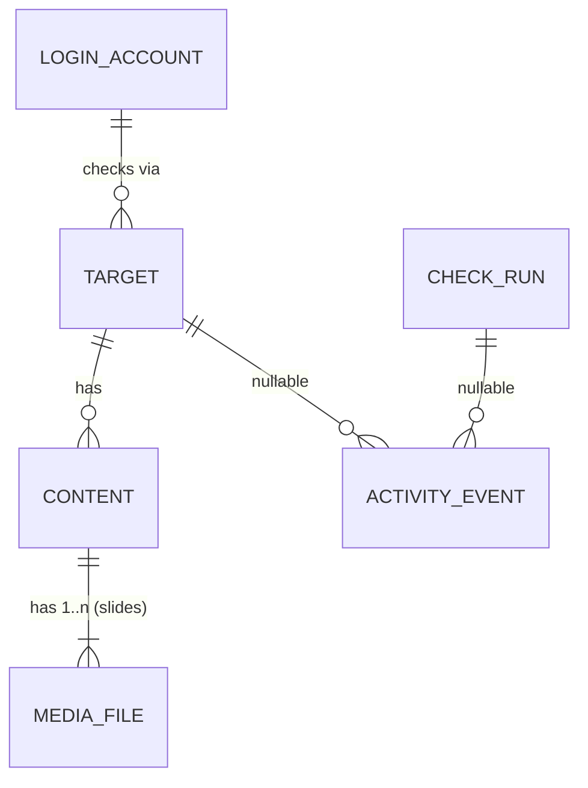

# Storize — Technical Specification

> Status: **v0.2 — Approved** · Owner: architect · Date: 2026-11-19 · Approved by: user, 2026-11-19 (+ Reels toggle, repo Amr905/Storize)
> Inputs: `REQUIREMENTS.md` v0.2, `UX.md` v0.2. Decisions: `docs/decisions/0001…0011` (**[ADR-n]**).
> Implementation has **not** started.
>
> **v0.2 changes (user feedback):** Flutter instead of Kotlin (ADR-1) · media saved to the gallery `Pictures/Storize/<username>/` (ADR-5) ·
> extraction based on watching the real page, with a page-render fallback (ADR-3) · new-post tracking (ADR-10) · public GitHub repo (ADR-8) ·
> small native Android plugin for MediaStore (ADR-11).

---

## 0. Summary

| Area | Decision |
|------|----------|
| App type | A Flutter app, **Android first** (D-13). No backend server (D-5) |
| Language / UI | Dart 3 + Flutter (current stable), Material 3 **[ADR-1]** |
| Structure | A Dart pub **workspace**: `app` + 5 packages, with Melos for scripts **[ADR-2]** |
| State / navigation | Riverpod · go_router |
| Instagram access | Method worked out by watching the real page (spike). **Direct mode:** replay the page's own JSON requests with the session. **Page mode (fallback):** load the page in a headless WebView and take the media links from it. Media files are always fetched with a plain HTTP download **[ADR-3]** |
| Background work | `workmanager` plugin, which runs on Android WorkManager **[ADR-4]** |
| Local data | drift (SQLite) for records, shared_preferences for settings |
| Media files | **The phone gallery:** `Pictures/Storize/<username>/` through MediaStore, using a small native Kotlin plugin **[ADR-5, ADR-11]** |
| Secrets | flutter_secure_storage (Android Keystore) for the session; PIN as a PBKDF2 hash **[ADR-6]** |
| Observability | On-device only **[ADR-7]** |
| Distribution | **Public** GitHub repo; signed APK on GitHub Releases; the in-app update check uses the GitHub Releases API **[ADR-8]** |
| Anti-ban | One `RequestGovernor` for every Instagram call, shared by story and post checks **[ADR-9]** |
| Detection | Stories: batched reel requests. Posts: a per-account feed request with a "from-now" watermark **[ADR-10]** |

**Android baseline:** minSdk 26 (NFR-1), targetSdk/compileSdk 36. **iOS:** not built in the MVP. Packages avoid
Android-only Dart APIs except behind `storize_platform_android`, so iOS stays possible later.
Versions are pinned in each `pubspec.yaml` at T-001 (latest stable at that time).

---

## 1. System architecture

### 1.1 Context
```mermaid
flowchart LR
  U[Team member] --> APP[Storize Flutter app (Android)]
  APP -->|WebView login + page mode| IGW[instagram.com pages]
  APP -->|HTTPS + session cookies (direct mode)| IGA[Instagram internal JSON requests]
  APP -->|plain HTTPS download| CDN[Instagram media CDN]
  APP -->|HTTPS GET| GH[GitHub Releases API (public repo)]
  APP --> OS[(Android: WorkManager, Keystore,<br/>MediaStore gallery, Notifications)]
```

### 1.2 Packages and layers
```mermaid
flowchart TB
  subgraph app["app/ — Flutter UI & wiring"]
    UI[Screens S-01…S-15, Riverpod providers] --- BG[Background entrypoint (workmanager callbackDispatcher)]
  end
  subgraph domain["packages/storize_domain — pure Dart"]
    UC[Use cases] --> PORTS[Ports: ContentPlatform, repos, SessionStore,<br/>GalleryStore, Scheduler, Clock]
  end
  subgraph data["packages/storize_data — Flutter"]
    DB[(drift DB)] --- REPO[Repo impls]
    SP[(shared_preferences)] --- REPO
    SEC[flutter_secure_storage vault]
  end
  subgraph ig["packages/storize_instagram — Flutter"]
    DIR[DirectExtractor (dio)] --> GOV[RequestGovernor]
    PAGE[PageExtractor (HeadlessInAppWebView)] --> GOV
    ADP[InstagramPlatform : ContentPlatform] --> DIR
    ADP --> PAGE
  end
  subgraph native["packages/storize_platform_android — Flutter plugin (Kotlin)"]
    MS[MediaStore insert/delete/query] --- BAT[Battery & OEM intents]
  end
  subgraph model["packages/storize_model — pure Dart"]
    M[Entities, enums, Result/Failure]
  end
  app --> domain & data & ig & native
  data --> domain
  data --> native
  ig --> domain
  domain --> model
```
- **Dependency rule:** `storize_domain` and `storize_model` are pure Dart (no Flutter, no Instagram). They're testable with `dart test`.
- Future platforms (Facebook/TikTok/Snapchat) arrive as `packages/storize_<platform>` implementing `ContentPlatform` (NFR-8).

### 1.3 Runtime: story check run (post runs are the same, using `fetchNewPosts`)
```mermaid
sequenceDiagram
  participant WM as WorkManager (workmanager plugin)
  participant BG as Background isolate
  participant UC as RunCheck(scope=STORIES)
  participant IG as InstagramPlatform
  participant DB as drift
  participant DL as DownloadPending
  participant GS as GalleryStore (native)
  WM->>BG: task "check-stories"
  BG->>UC: run(trigger)
  UC->>DB: session state, targets where track_stories
  alt session not ACTIVE
    UC-->>BG: SKIPPED_SESSION (BR-7)
  else
    UC->>IG: fetchStories(ids, chunks ≤ 20)
    IG->>IG: direct mode → on SchemaChanged: page mode (if allowed)
    IG-->>UC: items | Failure
    UC->>DB: insert content + media_file (PENDING); update targets; check_run; activity
    UC->>DL: run (same task while time remains, else enqueue "download")
    DL->>IG: openMedia(url, range)  (plain HTTPS GET)
    DL->>DL: stream to cache/.part
    DL->>GS: insert into Pictures/Storize/<username>/ (IS_PENDING → 0)
    DL->>DB: media_file DONE (contentUri, size); thumbnail into app cache
    DL->>BG: notify grouped (FR-40/FR-66)
  end
```
**The 10-minute rule:** each WorkManager task stops cleanly after about 8 minutes. Remaining PENDING items roll over to a one-off
`download` task. This avoids needing a foreground service.

---

## 2. Component responsibilities

| Component | Package | Responsibility | Reqs |
|-----------|---------|----------------|------|
| `StorizeApp`, `router` | app | MaterialApp, go_router routes, deep links, app-lock gate | UX §3 |
| Feature providers/controllers (Library, PostViewer, StoryViewer, Targets, AddTarget, TargetDetail, Activity, Settings, Account, Setup, Lock) | app | Turn domain streams into `UiState` and handle intents | S-01…S-15 |
| `LoginScreen` + `SessionCapture` | app | `InAppWebView` for login; reads cookies through `CookieManager` (HttpOnly included on Android); saves to the vault; clears WebView data | FR-1, FR-2 |
| `callbackDispatcher` | app | Background entrypoint. Builds a minimal provider container and routes tasks (`check-stories`, `check-posts`, `download`, `retention`, `update-check`) to use cases | FR-20, FR-64 |
| `NotificationService` | app | flutter_local_notifications: channels, grouped story/post notifications, login/storage alerts | FR-40…FR-42, FR-66 |
| `BatteryGuide` | app + native | Detects the manufacturer (device_info_plus), opens battery-optimization settings and OEM screens (native plugin) | FR-51 |
| Use cases (`AddTarget`, `RunCheck`, `DownloadPending`, `RemoveTarget`, `DeleteContent`, `ApplyRetention`, `DetectGaps`, `ComputeStorage`, `VerifySession`, `ExportZip`(C)) | domain | Business rules BR-1…BR-9, EC-1…EC-22 | §6, §8, §9 |
| `ContentPlatform` (port) | domain | The contract for any platform (§4.3) | NFR-8 |
| `InstagramPlatform` | instagram | Implements the port. Picks direct or page mode, maps failures | FR-29 |
| `DirectExtractor` | instagram | dio requests that copy what the real page requests (found in the spike); JSON → model | FR-29 |
| `PageExtractor` | instagram | `HeadlessInAppWebView` with the session cookies. Loads the story, profile or post page, captures JSON responses through an injected fetch/XHR hook, and reads ``/`<video src>` as a last resort | FR-29, EC-14 |
| `RequestGovernor` | instagram | Token bucket, jitter, back-off, one call in flight | NFR-4, BR-5, EC-15, R-8 |
| Repositories (`TargetRepo`, `ContentRepo`, `AccountRepo`, `ActivityRepo`, `CheckRunRepo`, `SettingsRepo`) | data | drift/shared_prefs access exposed as `Stream`s | — |
| `SessionVault` | data | Read, write and clear the session blob in flutter_secure_storage | FR-2, NFR-5 |
| `GalleryStore` | data → native | Insert a file into `Pictures/Storize/<username>/`, delete it, check it exists, get its size and URI | FR-33, BR-9, EC-20 |
| `MediaCache` | data | Temp `.part` files and thumbnails in the app cache | NFR-7 |
| `UpdateChecker` | data | GitHub Releases API → newer tag? | NFR-9 |
| `DiagnosticLog` | data | `logging` package → rotating, redacted file | §8 |
| `AppLock` | app + data | local_auth (biometric), PBKDF2 PIN, cooldown, re-lock | A-4 |
| **`storize_platform_android`** (Kotlin) | native | MethodChannel `storize/media` (insert, delete, exists, size, video thumbnail) · `storize/system` (OEM intents, battery-exemption status, `WorkInfo.stopReason`) | ADR-11 |

---

## 3. Database schema and relationships (drift, `storize.sqlite`, schema v1)


A **story** is a `content` row (kind STORY) with exactly one `media_file`. A **post** is a `content` row (kind POST)
with 1…n `media_file` rows (carousel slides, FR-61).

### `login_account`
| Column | Type | Notes |
|--------|------|-------|
| id | INTEGER PK | MVP: one row (FR-6 is Could) |
| platform | TEXT | `INSTAGRAM` |
| remote_user_id | TEXT UNIQUE NOT NULL | `ds_user_id` |
| username | TEXT NOT NULL | |
| status | TEXT | `ACTIVE`, `NEEDS_RELOGIN`, `RESTRICTED`, `LOGGED_OUT` |
| status_reason | TEXT | |
| connected_at, last_success_at | INTEGER | epoch ms UTC |
| user_agent | TEXT | The WebView UA; reused by dio |

### `target`
| Column | Type | Notes |
|--------|------|-------|
| id | INTEGER PK | |
| platform | TEXT | |
| remote_user_id | TEXT NOT NULL | FR-13 |
| username, display_name | TEXT | Username refreshed each check (EC-5) |
| avatar_path | TEXT | App cache |
| category | TEXT NOT NULL | `OWN_CLIENT`, `CONSENTED`, `PUBLIC` (BR-1) |
| note | TEXT | ≤ 200 characters |
| status, status_reason | TEXT | `ACTIVE`, `PAUSED`, `NOT_VISIBLE`, `UNAVAILABLE`, `ERROR` |
| is_private | INTEGER | |
| track_stories, track_posts, track_reels | INTEGER | All default 1; CHECK (track_stories + track_posts + track_reels ≥ 1) (FR-65, FR-67) |
| posts_watermark_at | INTEGER NOT NULL | `taken_at` of the newest post when the account was added; only newer posts are downloaded (FR-63) |
| login_account_id | INTEGER FK | `ON DELETE SET NULL` |
| added_at, last_stories_check_at, last_posts_check_at, last_new_story_at, last_new_post_at | INTEGER | |
| UNIQUE (platform, remote_user_id) | | EC-16 |

### `content`
| Column | Type | Notes |
|--------|------|-------|
| id | INTEGER PK | |
| target_id | INTEGER FK | `ON DELETE CASCADE` (files are deleted first by the use case, BR-6/BR-9) |
| kind | TEXT | `STORY`, `POST` |
| remote_id | TEXT NOT NULL | Media pk |
| shortcode | TEXT | Posts: the `/p/<code>/` link (FR-62) |
| post_type | TEXT | `PHOTO`, `VIDEO`, `CAROUSEL`, `REEL` (A-17) |
| posted_at | INTEGER | |
| expires_at | INTEGER | Stories only |
| caption | TEXT | Posts (FR-62) |
| slide_count | INTEGER | |
| is_close_friends | INTEGER | FR-27 |
| extras_json | TEXT | Link stickers, mentions, location |
| detected_at | INTEGER | |
| status | TEXT | `PENDING`, `PARTIAL`, `DONE`, `REMOVED_BEFORE_DOWNLOAD` |
| viewed | INTEGER | The "new" ring |
| UNIQUE (target_id, kind, remote_id) | | FR-23, BR-3 |
| INDEX (kind, posted_at DESC), INDEX (target_id, kind, posted_at DESC) | | NFR-12, filters |

### `media_file`
| Column | Type | Notes |
|--------|------|-------|
| id | INTEGER PK | |
| content_id | INTEGER FK | `ON DELETE CASCADE` |
| slide_index | INTEGER | 0 for stories |
| media_type | TEXT | `PHOTO`, `VIDEO` |
| source_url | TEXT | Signed CDN URL (expires; refreshed on 403) |
| status | TEXT | `PENDING`, `DOWNLOADING`, `DONE`, `FAILED`, `FILE_MISSING` |
| attempts | INTEGER | Max 5 |
| content_uri | TEXT | MediaStore URI once saved |
| relative_path, display_name | TEXT | `Pictures/Storize/nour_k/`, `nour_k_20261119_101503_3245…_2.jpg` |
| thumb_path | TEXT | App cache |
| width, height, duration_ms, size_bytes | INTEGER | |
| downloaded_at | INTEGER | |
| UNIQUE (content_id, slide_index), INDEX (status) | | |

### `check_run`
`id, scope (STORIES|POSTS), trigger (PERIODIC|MANUAL_ALL|MANUAL_ONE|FIRST_CHECK), started_at, finished_at,
result (OK|PARTIAL|SKIPPED_SESSION|RATE_LIMITED|FAILED), mode (DIRECT|PAGE), targets_checked, new_items, error_code` — INDEX (scope, started_at).

### `activity_event`
`id, at, type, severity, target_id?, check_run_id?, count, payload_json` — INDEX (at DESC), pruned after 7 days (FR-52).
FKs (as built in T-005): `target_id` → `target.id` ON DELETE SET NULL, `check_run_id` → `check_run.id` ON DELETE SET NULL. An extra index `idx_target_status` exists on `target(status)`.
Types: `CHECK_DONE`, `DOWNLOADED_STORIES`, `DOWNLOADED_POSTS`, `REMOVED_BEFORE_DOWNLOAD`, `GAP`, `RATE_LIMITED`, `SESSION_PROBLEM`,
`PLATFORM_CHANGED`, `PAGE_MODE_USED`, `STORAGE_LOW`, `STORAGE_PAUSED`, `TARGET_STATUS`, `FILE_MISSING`, `APP_CRASH`.

### `governor_lease`
`login_account_id PK, holder (isolate/task id), expires_at, tokens, last_refill_at, backoff_until, backoff_multiplier`.
It keeps the RequestGovernor consistent between the UI isolate and background isolates (ADR-9).

### Settings (shared_preferences)
`storyIntervalMin` ∈ {15, 30, 60, 120, 180, 360} = 30 · `postIntervalMin` ∈ {60, 120, 180, 360, 720, 1440} = 180 · `wifiOnly` = false ·
`notifyStories` = `notifyPosts` = `notifyLogin` = true · `retentionDays` = null · `appLockEnabled` · `onboardingDone` ·
`riskAcknowledgedAt` · `pageModeInBackground` = false (set true only if the spike proves it works, §4.1) · `lastUpdateCheckAt`.

### Files
```
Gallery (shared, visible):  Pictures/Storize/<username>/<username>_<yyyyMMdd_HHmmss>_<remoteId>[_<slide>].<jpg|mp4>
App cache (private):        cache/part/<mediaFileId>.part · files/thumbs/<mediaFileId>.webp · files/avatars/<targetId>.jpg
App files (private):        files/logs/storize.log(.1,.2) · storize.sqlite
```
- The folder name is the username **when the file is downloaded**. If someone renames their account, new files go into a new
  folder; old files stay where they were, and the library still groups everything by the stable user ID (EC-5).
- **Videos:** if MediaStore refuses `Pictures/` for a video (some Android 10 builds do), the plugin saves it under `Movies/Storize/<username>/` instead and returns that `relativePath`. `media_file.relative_path` stores what the plugin returned (T-009).
- **Final file name:** the plugin returns the final `displayName`, which MediaStore may have renamed to `name (1).ext`; store it in `media_file.display_name`.
- **Android 10+:** no storage permission needed. Storize owns the files it inserts, so it can delete them without a system prompt (BR-9).
- **Android 8–9:** `WRITE_EXTERNAL_STORAGE` (maxSdk 28), a direct file write plus a MediaScanner scan (UX S-03 card).
- **After reinstall:** the files stay in the gallery, but Storize no longer owns or indexes them (EC-19, out of scope).

**Migrations:** drift schema versions with generated step-by-step migrations and `drift_dev` schema dumps in `packages/storize_data/drift_schemas/`, tested in CI.

---

## 4. API endpoints and contracts

### 4.1 Instagram: how extraction is found and run (FR-29, D-12) **[ADR-3]**

**Step 0 — spike T-002, "watch the real page":**
1. Log in with the dedicated test account in desktop Chrome (DevTools → Network, "Preserve log"). Also log in with a debug build
   of Storize whose WebView has remote debugging on (`chrome://inspect`), so the same UA and cookies are observed.
2. Open, one at a time: `https://www.instagram.com/stories/<user>/` · `https://www.instagram.com/<user>/` ·
   `https://www.instagram.com/p/<shortcode>/` (photo, video, carousel, reel).
3. For each page, record which request returns the item list with media links, plus its URL, headers, query and response shape.
   Also record where `` and `<video src>` point (the CDN URLs).
4. Download one image and one video by opening the CDN URL directly, which confirms a plain download works without cookies.
5. Write the findings into `docs/03-specs/INSTAGRAM_EXTRACTION.md` and save **sanitized** response fixtures to
   `packages/storize_instagram/test/fixtures/`. The repo is public (D-14), so fixtures must contain no cookies, no tokens,
   and only the test account's own content.
6. Test whether `HeadlessInAppWebView` runs inside the workmanager background isolate on 2 phones.
   The result sets the `pageModeInBackground` default.

**Candidate requests to look for** (known from open-source clients; **to be confirmed or replaced by the spike**):
| # | Purpose | Candidate request | Key fields |
|---|---------|-------------------|-----------|
| IG-1 | Username → user (add, refresh) | `GET /api/v1/users/web_profile_info/?username={u}` | `id, username, full_name, is_private, followed_by_viewer, blocked_by_viewer, profile_pic_url`; may also include the latest ~12 posts |
| IG-2 | Stories for ≤ 20 users | `GET /api/v1/feed/reels_media/?reel_ids={id}&reel_ids=…` | `reels.{id}.items[]`: `pk, taken_at, expiring_at, media_type, image_versions2.candidates[], video_versions[], video_duration, audience, story_link_stickers` |
| IG-3 | User by ID | `GET https://i.instagram.com/api/v1/users/{id}/info/` | `user.username, is_private`; 404 = gone |
| IG-4 | Validate session | `GET /api/v1/accounts/current_user/?edit=true` | `user.pk == ds_user_id` |
| IG-5 | Latest posts of a user | `GET /api/v1/feed/user/{id}/?count=12` | `items[]`: `pk, code, taken_at, media_type (1/2/8), product_type ("clips" = reel), carousel_media[], caption.text, image_versions2, video_versions` |
| CDN-1 | The file itself | `GET <CDN URL>` with optional `Range`; no cookies | binary; 403 = expired, so refresh |

Common headers in direct mode: the session cookies, `User-Agent` (the WebView UA), `X-IG-App-ID`, `X-CSRFToken`,
`Referer: https://www.instagram.com/`. The exact set is whatever the spike observes.

**Direct mode** (normal, background-safe): `DirectExtractor` sends the observed requests through dio and parses them tolerantly
(unknown fields ignored, missing required fields → `SchemaChanged`).

**Page mode** (fallback): `PageExtractor` creates a `HeadlessInAppWebView` with the session cookies set on `.instagram.com`, then:
1. Injects a `UserScript` at document start that wraps `fetch` and `XMLHttpRequest` and posts response bodies whose URL matches
   the spike's patterns to a JS handler.
2. Loads the page (story, profile or post URL) and waits until the JSON arrives or 20 s pass.
3. Last resort: evaluates JS that collects `video.currentSrc` / `img.srcset` (largest candidate).

The result goes through the **same mapper** as direct mode.

**When page mode is used:** if direct mode returns `SchemaChanged` → page mode for that run. In the foreground it's always
allowed; in background only if `pageModeInBackground` is true. Each use logs `PAGE_MODE_USED`. After 3 page-mode runs in a row,
the EC-14 banner appears ("Instagram changed — update Storize").

**Media download is always the "normal" way:** the best candidate's CDN URL fetched with a plain GET (FR-29).
- **Photos:** the largest `width×height`.
- **Videos:** the highest-resolution progressive MP4 with audio. A video with no audio track is saved as-is (EC-17).
- **DASH-only videos** (if the spike finds them): take the progressive variant if one exists; otherwise mark the item
  `FAILED(unsupported_stream)` and raise an open question. MP4 muxing isn't in scope.

**Failure map → `Failure`** (§7): 401 / `login_required` / redirect to login → `SessionInvalid(loginRequired)` ·
`checkpoint_required` / `challenge_required` → `SessionInvalid(challenge)` · `feedback_required` / disabled → `AccountRestricted` ·
429 / "Please wait" → `RateLimited` · user null / 404 → `TargetNotFound` · private & not followed / blocked → `TargetNotVisible` ·
missing fields → `SchemaChanged` · socket/timeout → `NetworkFailure`.

### 4.2 GitHub Releases (update check, NFR-9) **[ADR-8]**
`GET https://api.github.com/repos/Amr905/Storize/releases/latest` (unauthenticated; once a day). Fields used:
- `tag_name` (`v1.2.0`) → compared with the app version.
- `html_url` → opened in the browser.
- `body` → must contain a `min-supported: <version>` line and an `sha256: <hash>` line (written by CI).

The app never installs anything itself.

### 4.3 Internal contracts (port interfaces in `storize_domain`)
```dart
abstract interface class ContentPlatform {
  PlatformId get id;
  Future<Result<RemoteUser>> resolveUser(String username);                                  // IG-1
  Future<Result<RemoteUser>> refreshUser(String remoteUserId, String lastUsername);         // IG-3 / IG-1
  Future<Result<Map<String, List<RemoteContent>>>> fetchStories(List<String> userIds,
      {required ExtractionPolicy policy});                                                   // IG-2
  Future<Result<List<RemoteContent>>> fetchNewPosts(String userId, DateTime watermark,
      {required ExtractionPolicy policy});                                                   // IG-5
  Future<Result<DateTime?>> latestPostTime(String userId);                                   // watermark at add (FR-63)
  Future<Result<RemoteUser>> verifySession();                                                // IG-4
  Stream<List<int>> openMedia(String url, {int fromByte = 0});                               // CDN-1
}

sealed class Result<T> { const Result(); }
final class Ok<T> extends Result<T> { const Ok(this.value); final T value; }
final class Err<T> extends Result<T> { const Err(this.failure); final Failure failure; }

sealed class Failure {}
final class NetworkFailure extends Failure {}
final class RateLimited extends Failure { RateLimited(this.retryAfter); final Duration? retryAfter; }
final class SessionInvalid extends Failure { SessionInvalid(this.reason); final SessionReason reason; }
final class AccountRestricted extends Failure {}
final class TargetNotFound extends Failure {}
final class TargetNotVisible extends Failure {}
final class SchemaChanged extends Failure { SchemaChanged(this.where); final String where; }
final class UnknownFailure extends Failure { UnknownFailure(this.code, this.message); final int? code; final String? message; }

enum ExtractionPolicy { directOnly, directThenPage }

class RemoteContent {          // a story or a post
  final String remoteId; final ContentKind kind; final String? shortcode; final PostType? postType;
  final DateTime postedAt; final DateTime? expiresAt; final String? caption; final bool closeFriends;
  final List<RemoteMedia> slides; final Map<String, Object?> extras;
}
class RemoteMedia { final int index; final MediaType type; final String url; final int width, height; final Duration? duration; }

abstract interface class GalleryStore {          // native plugin behind it
  Future<GalleryFile> save({required String sourcePath, required String relativeDir, required String displayName, required String mime});
  Future<bool> delete(String contentUri);
  Future<bool> exists(String contentUri);
}
abstract interface class SessionStore { Future<void> save(int accountId, SessionBlob s); Future<SessionBlob?> load(int accountId); Future<void> clear(int accountId); }
abstract interface class Scheduler { Future<void> apply({required int storyMin, required int postMin, required bool wifiOnly}); Future<void> checkNow({CheckScope scope = CheckScope.all, int? targetId}); Future<void> cancelAll(); }
```

**Selected use-case contracts:**
| Use case | Input → output | Rules |
|----------|----------------|-------|
| `AddTarget` | `(raw, category, trackStories, trackPosts, note?)` → `Added(id, overLimitWarning)` \| `InvalidUsername` \| `NotFound` \| `NotVisible` \| `Duplicate(id)` \| `SessionNotActive` \| `Network` | UX S-08 normalization + regex, BR-1, BR-2, EC-16, A-12. **Sets `posts_watermark_at` from `latestPostTime`** (FR-63) |
| `RunCheck` | `(scope, trigger, targetId?)` → `CheckRunResult` | BR-5, BR-7, EC-3…EC-7, EC-15, FR-65 |
| `DownloadPending` | `(deadline)` → `DownloadSummary(newStoriesPerTarget, newPostsPerTarget, remaining)` | FR-23, FR-25, FR-33, NFR-7, NFR-13, EC-21 |
| `DeleteContent` | `(contentIds)` → `Unit` | BR-9 (gallery file deleted first, then rows) |
| `RemoveTarget` | `(targetId, deleteMedia)` → `Unit` | BR-6, BR-9 |
| `DetectGaps` | `(now)` → `Gap?` | EC-10/11: a story-check gap is when `now − last story run > max(2×interval, interval + 30 min)` |

**New-post rule (FR-63, FR-67):** a post is new when `posted_at > target.posts_watermark_at` and `(target, POST, remote_id)` isn't stored yet.
The post run fetches the feed when `track_posts` **or** `track_reels` is on. It keeps items with `post_type = REEL` only if `track_reels`, and all other types only if `track_posts`.
Pinned posts (old `taken_at` at the top of the feed) are therefore ignored. After each successful post run, the watermark moves to the newest `posted_at` seen.

**Background tasks (workmanager):**
| Unique name | Kind | Frequency | Constraints | Policy |
|-------------|------|-----------|-------------|--------|
| `check-stories` | periodic | `storyIntervalMin` (≥ 15) | network connected | replace on settings change |
| `check-posts` | periodic | `postIntervalMin` (≥ 60), initial delay offset so it doesn't coincide with stories | network connected | replace on settings change |
| `check-now-{scope}-{target?}` | one-off, expedited where available | — | network | keep |
| `download` | one-off | — | `unmetered` if Wi-Fi only; storage not low | append/replace |
| `retention` | periodic | 24 h | — | keep |
| `update-check` | periodic | 24 h | network | keep |

**Deep links (internal):** `storize://story/{contentId}` → S-06 · `storize://post/{contentId}` → S-15 · `storize://account` → S-13 ·
`storize://library?kind=posts&target={id}` → S-04 · `storize://settings/storage` → S-12.
**Notification channels:** `new_stories`, `new_posts`, `login_problems` (high), `storage` (high), `background` (silent), `export`.

---

## 5. Authentication and authorization

### 5.1 Instagram session (FR-1…FR-5)
1. S-02: an `InAppWebView` loads `https://www.instagram.com/accounts/login/`. A navigation allowlist covers `instagram.com` and
   `facebook.com` (FB-login variant); anything else opens in the browser.
2. On each page load: `CookieManager.instance().getCookies(url: instagram.com)` → success when `sessionid` and `ds_user_id` are present.
3. Confirm with IG-4, then store `{cookies, userAgent, capturedAt}` in `SessionVault` (flutter_secure_storage, Keystore-backed)
   and upsert `login_account(ACTIVE)`. Then clear the WebView's cookies and storage, so the session exists only in the vault.
   **Page mode** re-injects the cookies into its own headless WebView for each run and clears them afterwards.
4. The password is never read (FR-2).
5. On `SessionInvalid` or `AccountRestricted`: change the status, stop all checks (BR-7), notify (FR-41). No automatic re-login.
6. Re-login with a different account: confirm, then re-point targets and re-evaluate NOT_VISIBLE.

### 5.2 App access (A-4)
- There's no Storize account or backend. **Authorization model:** one role (D-6), so there are no permission checks in code.
- **Optional app lock:** `local_auth` (strong biometrics) with Storize's own PIN as the fallback. The PIN is stored as
  `PBKDF2-HMAC-SHA256(pin, 16-byte salt, 210 000 iterations)` (package `cryptography`) in flutter_secure_storage.
  Cooldown: 30 s after 5 failures. Re-lock after 60 s in the background.
- **Gallery files are outside the app lock** (NFR-6 v0.2). Settings S-12 says so under the App lock row.

---

## 6. Integration points

| Integration | Mechanism | Failure handling | Package |
|-------------|-----------|------------------|---------|
| Instagram login pages | flutter_inappwebview `InAppWebView` | Page error → Retry UI | app |
| Instagram JSON (direct mode) | dio + RequestGovernor | §4.1 failure map | instagram |
| Instagram pages (page mode) | `HeadlessInAppWebView` + UserScript hook | 20 s timeout → `SchemaChanged` | instagram |
| Instagram CDN | dio streaming GET, `Range` resume | 403 → refresh URL once | instagram |
| GitHub Releases API | dio GET | Silent; retried next day | data |
| WorkManager | `workmanager` plugin | Delays → gap detection; `stopReason` logged via native | app/native |
| MediaStore (gallery) | `storize_platform_android` MethodChannel | Insert failure → item FAILED + activity | native/data |
| Notifications | flutter_local_notifications; `permission_handler` for POST_NOTIFICATIONS | Denied → S-03 shows it | app |
| Battery / OEM settings | `permission_handler` (ignoreBatteryOptimizations) + native OEM intents | Not resolvable → manual steps | app/native |
| Share | share_plus with MediaStore content URIs | — | app |
| Biometrics | local_auth | Unavailable → PIN only | app |
| Video / thumbnails | video_player (ExoPlayer) · native `MediaMetadataRetriever` frame → webp | Bad file → FILE_MISSING/error state | app/native |

---

## 7. Error handling
Errors are values (`Result`/`Failure`). A single target's failure never stops a run. Every failure has a retry policy, a UI surface
and a record.

| Failure | Retry | State change | UI | Activity |
|---------|-------|--------------|----|----------|
| `NetworkFailure` | WorkManager back-off; next period | — | Snackbar on manual | diagnostic only |
| `RateLimited` | Governor pauses all calls `retryAfter`/15 min; ×2 intervals for 2 h | — | S-07 bar, S-13 count | `RATE_LIMITED` |
| `SessionInvalid` | none (BR-7) | account → `NEEDS_RELOGIN` | Banner, notification | `SESSION_PROBLEM` |
| `AccountRestricted` | none | account → `RESTRICTED` | Red banner | `SESSION_PROBLEM` |
| `TargetNotVisible` | each run | target → `NOT_VISIBLE` | Badge, S-09 card | `TARGET_STATUS` |
| `TargetNotFound` | daily via IG-3 | target → `UNAVAILABLE` | Badge | `TARGET_STATUS` |
| `SchemaChanged` (direct) | page mode (if allowed) for that run | — | — | `PAGE_MODE_USED` |
| `SchemaChanged` (both modes, or 3 page runs in a row) | next period | — | "Instagram changed — update Storize" + update check | `PLATFORM_CHANGED` |
| CDN 403 | refresh URL via IG-2/IG-5 once | — | — | — |
| Item gone before download | — | content → `REMOVED_BEFORE_DOWNLOAD` | Info | `REMOVED_BEFORE_DOWNLOAD` |
| Slide failed after 5 attempts | — | media_file `FAILED`, content `PARTIAL` (EC-21) | "Not downloaded" slide | `DOWNLOADED_POSTS` with failures |
| Gallery insert fails / storage low | pause downloads | — | Snackbar/notification | `STORAGE_LOW`/`STORAGE_PAUSED` |
| Gallery file deleted by user (EC-20) | — | media_file `FILE_MISSING` | Broken tile / slide | `FILE_MISSING` |
| Uncaught error | `FlutterError.onError` + `PlatformDispatcher.onError` + background `runZonedGuarded` → DiagnosticLog | — | "Storize closed unexpectedly" entry | `APP_CRASH` |

The UI uses `AsyncValue`-backed `UiState` = loading / content / empty(reason) / error(kind, retry), mapping 1:1 to the UX state tables.

---

## 8. Logging and monitoring **[ADR-7]**
- **User-facing:** `activity_event` (7 days) feeds S-11. `check_run` (per scope) feeds S-13 health and gap detection.
- **Diagnostic file:** the `logging` package → a rotating file sink (3 × 1 MB) in release, console in debug. INFO and above in release.
- **Redaction** (unit-tested): `sessionid`, `csrftoken`, `ds_user_id`, `Cookie`, `Authorization`, signed URL params (`oh`, `oe`, `_nc_*`),
  PINs, captured JSON bodies (in release only their size is logged).
- **What's logged:** run start/end per scope and mode; each IG call (request id, status, duration, governor wait); page-mode
  triggers; worker stop reasons (native `WorkInfo.stopReason`, API 31+); state transitions.
- **No remote telemetry or crash reporting (NFR-6).**

---

## 9. Security considerations
| Concern | Control |
|---------|---------|
| Session theft at rest | flutter_secure_storage (Android Keystore-backed encryption); `allowBackup=false` and data-extraction rules that exclude everything |
| Password exposure | Never read (FR-2) |
| Session in logs or fixtures | Redaction (§8). **Public repo:** fixtures are sanitized and a CI check (gitleaks) fails on secrets or cookies |
| WebView abuse | Host allowlist; no JS handlers on the login WebView; the page-mode handler only accepts messages from instagram.com origins; file access off; WebView data cleared after use |
| Network | HTTPS only (`usesCleartextTraffic=false`). No certificate pinning (Instagram rotates certificates) |
| Media privacy | **Gallery files are visible to other apps and outside the app lock** (D-10). Documented in S-01 risk text and S-12 |
| Shared or stolen phone | Optional app lock (protects the app, its targets and session); PBKDF2 PIN, cooldown |
| Intents / deep links | Only the launcher activity is exported; notification intents are immutable PendingIntents; the plugin's channels aren't exposed outside the app |
| **Public repo** (D-14) | No secrets in the repo; signing key and passwords live in GitHub Actions secrets plus an offline backup; branch protection on `main`; Dependabot; gitleaks in CI. Code and APK are public by design (R-7) |
| Tampered APK | Signed releases; sha256 in the release notes; the update check never side-loads |
| Reverse engineering | Release built with `--obfuscate --split-debug-info` (raises the bar only) |
| Ban risk (R-1, R-8) | RequestGovernor shared by stories and posts; WebView UA reused; dedicated-account warning |
| Legal / privacy (R-4) | Consent category per target (BR-1); nothing leaves the phone except calls to Instagram and GitHub |

---

## 10. Deployment considerations **[ADR-8]**
**Repo layout** (replaces the placeholder `src/` and `tests/`):
```
/ (public repo root)
  pubspec.yaml            (workspace root: lists app + packages; dev: melos)
  melos.yaml / analysis_options.yaml
  app/                    Flutter app (lib/features/<name>/, lib/background/, lib/notifications/, android/)
  packages/storize_model/        pure Dart
  packages/storize_domain/       pure Dart
  packages/storize_data/         Flutter (drift, prefs, vault, gallery, logs, update)
  packages/storize_instagram/    Flutter (dio, inappwebview, governor, fixtures)
  packages/storize_platform_android/  Flutter plugin (Kotlin: MediaStore, OEM intents, stopReason, thumbnails)
  docs/ …                 (existing)
  .github/workflows/ci.yml, release.yml
```
- **Flavors:** `dev` (applicationId `.dev`, verbose logs) and `prod`.
- **CI (GitHub Actions, public repo = free minutes):**
  - On PR: `dart format --set-exit-if-changed`, `flutter analyze`, `melos run test` (unit + widget + golden), drift migration tests, gitleaks.
  - On tag `v*`: `flutter build apk --release --flavor prod --obfuscate --split-debug-info=build/symbols`, signed with secrets,
    a GitHub Release with the APK, its sha256 and a `min-supported:` line.
- **Install:** download the APK from Releases and allow "Install unknown apps" (README). Updates: the app shows "Update available",
  which opens the release page.
- **Versioning:** SemVer + build number; the drift schema version is tracked separately.
- **Hotfix path for Instagram changes:** fixture-based extractor tests → update the mapper or extractor → tag → in-app notice within 24 h.
  Meanwhile, page mode keeps the foreground "Check now" working.
- **Build environment:** Flutter stable + Android SDK 36 + JDK 17 on your PC, **or** GitHub Actions only. The Claude cloud workspace
  has no network for pub/Gradle. Your PC's device shell currently can't start because of low disk space (needs about 17 GB free).
- **Test devices:** at least 2 real phones (Samsung + Xiaomi/Oppo) for background reliability; a dedicated Instagram test account.

---

## 11. Testing strategy
| Layer | Tooling | Target |
|-------|---------|--------|
| Domain (pure Dart) | `test`, `mocktail`, fake clock | ≥ 90% lines; every BR/EC has a test |
| Instagram extractors | dio adapter mocks + sanitized fixtures; page-mode parser tested on saved HTML/JSON | Every failure-map row; carousel/reel/video/photo mapping |
| RequestGovernor | `fake_async` | Bucket, jitter bounds, back-off, shared budget |
| drift | in-memory DB; migration tests | Constraints (UNIQUE, CHECK, cascades) |
| Background | Use cases tested directly; `callbackDispatcher` routing test | Task routing, 8-min deadline rollover |
| Native plugin | Kotlin unit tests + one instrumentation test (insert/delete MediaStore) | Android 9, 10, 14 |
| UI | Widget tests; golden tests of S-01…S-15 states compared against the mockups | All UX §4 states |
| Device soak | `integration_test` + manual checklist, 24 h with 20 targets | NFR-2, NFR-3 |

## 12. Coding standards
- `flutter_lints` + `very_good_analysis`-level strictness; `dart format`.
- No `dynamic` in domain code; no `!` on nullable values without a comment.
- All strings in ARB files (`flutter_localizations`, RTL-ready, NFR-10). Use `EdgeInsetsDirectional` and `AlignmentDirectional`.
- I/O never runs in widgets; providers call use cases. The clock is injected (UTC storage, EC-18).
- Dartdoc on every public API in `storize_domain`.

## 13. Commands (copied to `CLAUDE.md`)
| Purpose | Command |
|---------|---------|
| Get dependencies | `flutter pub get` (workspace root) |
| Codegen (drift, riverpod) | `melos run gen` → `dart run build_runner build -d` in each package |
| Format check | `dart format --set-exit-if-changed .` |
| Static analysis | `flutter analyze` |
| All tests | `melos run test` |
| Golden update | `melos run golden:update` |
| Run on phone | `cd app && flutter run --flavor dev` |
| Release APK | `cd app && flutter build apk --release --flavor prod --obfuscate --split-debug-info=build/symbols` |

## 14. Risks → Tier L candidates
1. **Extraction spike (T-002)** and the `DirectExtractor` / `PageExtractor` (R-1, R-2, FR-29).
2. Session capture + vault (FR-2, NFR-5).
3. RequestGovernor with the shared story/post budget (NFR-4, R-8).
4. Background dispatcher + DownloadPending with the 8-minute deadline and resume (NFR-2, NFR-7).
5. The native MediaStore plugin (FR-33, BR-9, Android 8–9 path).
6. drift schema + migrations.
7. App lock.
8. Gap detection + OEM battery guide.

## 15. Traceability
| Requirement | Components |
|-------------|------------|
| FR-1…FR-5 | LoginScreen, SessionCapture, SessionVault, AccountRepo |
| FR-10…FR-16, FR-63, FR-65, FR-67 | AddTarget (watermark, track flags), IG-1, `target` |
| FR-20, FR-21, FR-26, FR-64 | Scheduler, `check-stories` / `check-posts`, RunCheck |
| FR-22…FR-25, FR-27, FR-28 | DownloadPending, CDN-1, mappers (live items dropped), `content`/`media_file` |
| FR-29 | §4.1 spike + DirectExtractor + PageExtractor |
| FR-30…FR-35 | ContentRepo streams, Library/StoryViewer/PostViewer, share_plus |
| FR-33, BR-9 | GalleryStore + native plugin, DeleteContent |
| FR-36 (C) | ExportZip use case |
| FR-40…FR-42, FR-66 | NotificationService, channels, settings |
| FR-50…FR-54 | SettingsRepo, BatteryGuide, ActivityRepo, ComputeStorage, `retention` |
| FR-60…FR-62 | IG-5 / page mode on profile & post pages, `content` (POST) + `media_file` slides |
| FR-6 (C) | Not in the MVP; the schema already supports several login accounts |
| NFR-1…NFR-13 | §0, ADR-4/5/6/7/9, §8, §9, §11 |
| BR-1…BR-9 | Use cases (§4.3), §5 |
| EC-1…EC-22 | §7, DetectGaps, §3 constraints and file rules |
| BR-4 | Rows and files are deleted only by DeleteContent, RemoveTarget(deleteMedia) or retention — never because the item expired or was removed remotely |
| EC-8 | DownloadSummary per target → one notification per target + group summary |
| EC-9 | `download` task uses `unmetered` when Wi-Fi only; items stay PENDING |
| EC-12, EC-13 | Storage thresholds (§7); `.part` + IS_PENDING insert + `Range` resume |

## 16. Open questions (architecture)
| ID | Question | Current design |
|----|----------|----------------|
| AQ-2 | ~~Private vs gallery storage~~ answered: gallery (D-10) | — |
| AQ-3 | ~~Update manifest location~~ answered: GitHub Releases API on the public repo | — |
| AQ-4 | ~~Repo~~ answered: https://github.com/Amr905/Storize (public) | — |
| AQ-5 | Free ~17 GB on the PC for local builds, or use GitHub Actions only? — not answered | Both supported; see TASKS prerequisites |
| AQ-6 | Page mode in background — not answered; **default kept: foreground only** | Off by default |
| AQ-7 | If the spike finds DASH-only videos (separate audio/video), may we add muxing (e.g. FFmpeg, +~20 MB APK)? | Not in scope; flagged |

## 17. v0.3 additions (2026-11-24): today on add, post history, highlights

Requirements: FR-63 (changed), FR-68…FR-72, D-17…D-19.

### 17.1 Model (`storize_model`)
- `ContentKind.highlight('HIGHLIGHT')`. A highlight item is stored like a story item, plus `highlightId`, `highlightTitle` and `highlightOrder` in `extras`.
- `HistoryRange { none, today, days7, days30, since, all }`, plus `historySince: DateTime?` when the range is `since`.
- `HistoryState { idle, running, paused, done, failed }` and `HistoryProgress(state, cursor?, fetched, oldestSeenAt?, updatedAt)`.
- `PostPage(items: List<RemoteContent>, nextCursor: String?)`.
- `RemoteHighlight(id, title, coverUrl?, itemCount?, latestItemAt?)`.

### 17.2 Ports (`storize_domain`, Lead-approved)
`ContentPlatform` gains:
```dart
Future<Result<PostPage>> fetchPostPage(String userId, {String? cursor, required ExtractionPolicy policy});
Future<Result<List<RemoteHighlight>>> fetchHighlights(String userId, {required ExtractionPolicy policy});
Future<Result<Map<String, List<RemoteContent>>>> fetchHighlightItems(List<String> highlightIds, {required ExtractionPolicy policy});
```
- `TargetRepo` and `Target` gain `historyRange`, `historySince`, `historyProgress` and `highlightsEnabled`, with drift schema v+1 and a migration.
- `ContentRepo` dedupes highlight items by `(target, remoteId, kind)`, like every other kind.

### 17.3 Use cases
- **AddTarget (FR-63):** the post watermark is the **start of today** (device local), and `latestPostTime` is no longer called on add. Today's posts and live stories arrive with the first check.
- **BackfillHistory.step(targetId):**
  - Fetches **one** page (`fetchPostPage` with the stored cursor).
  - Queues new posts for download, respecting the Posts/Reels toggles and the range start, and saves the progress.
  - Stops with `done` when `nextCursor` is null or the page's oldest item is older than the range start.
  - A rate limit or a session failure leaves the state `running`, so the next run resumes.
- **SyncHighlights.run(targetId):** fetches highlights, then the items of highlights that are new or changed (by `latestItemAt`), and queues new items.
- **Ordering:** both run in background tasks **after** regular checks (lower priority), through the governor. The `history` task re-enqueues itself while any target is `running`, at most one page per target per run.

### 17.3a Queued add (FR-73, T-046)
- `TargetStatus.pendingLookup` (`PENDING_LOOKUP`). A pending target keeps the chosen options (including `historyRange`, `historySince`, `highlightsEnabled`) and the start-of-today watermark. Its `remoteUserId` is the placeholder `pending:<username>`, because the column is UNIQUE (no schema change); the real ID replaces it on success (`Target.copyWith(remoteUserId:)`).
- **AddTarget:** a `RateLimited` (governor pause and `maxWait` included) or `NetworkFailure` from `resolveUser` saves the target as pending and returns `AddTargetPending`, then calls `checkNow(scope: posts, targetId)`. Duplicates are also matched by username (case-insensitive) before any call. Not found, not visible and session failures still fail inline.
- **ResolvePendingTargets.run({deadline}):** oldest first, one `resolveUser` at a time. Success fills the ID and profile, sets `active` (or `notVisible` for private-not-followed or blocked) and starts `BackfillHistory` when a range is set. Rate limit, network or session failure stops the run and leaves the rest pending. `TargetNotFound` gives `unavailable`; `TargetNotVisible` gives `notVisible`. If the resolved ID is already another target, the pending row is deleted and the existing one is kept (a pending row never has content). Rows are re-read before each write.
- **Where it runs:** at the start of every `check-stories` and `check-posts` task (`TaskRouter`), and at app open and every resume (through the discovery-refresh hook). Checks, history and highlights ignore pending targets (they are not `active`). A pending target cannot be paused.

### 17.4 Governor: interactive calls never hang
`RequestGovernor.run(..., maxWait: Duration?)`: when the tokens or backoff would make the call wait longer than `maxWait`, it returns at once with `RateLimited(retryAfter: <the wait>)`. Interactive paths (S-08 add, S-02 verify, Check now resolve) use `maxWait: 8 s`; background jobs keep waiting.

### 17.4a In-page fetch (T-050, ADR-0003 amendment 4)
`InPageClient` (storize_instagram/page) keeps one headless session per run on `https://www.instagram.com/`; `InPageOps` runs the shared `DirectExtractor` logic over an `InPageTransport` whose requests are run in the page by `assets/inpage_query.js` (`__storizeQuery(name, varsJson)`, allowlist, `for (;;);` stripped, missing `.graphql` modules loaded with `requireLazy`). Governor costs: 3 for the session load, 1 per query. `InstagramPlatform` tries in-page first for every op; only `UnknownFailure('inpage_unavailable')` falls back to direct, then page mode. `RequestGovernor.run(priority:)` (`interactive` default, `background` leaves `interactiveReserve` = 3 tokens) and `withPriority` for background isolates. Kill switch `storize.inPageInBackground` (default true). Task budget 9 min with a 30 s start margin. Dev only: `RequestGovernor.runUnmetered`.

### 17.4b Profile preview (FR-74, T-052)
`PreviewProfile` (domain) resolves the user, then `fetchStories([id])` and `fetchPostPage(id, cursor: null)` with `ExtractionPolicy.directThenPage` (the policy of manual checks), and returns `ProfilePreview` (a failure of one part never hides the other). It runs in the foreground, where page mode and in-page are allowed without the user-initiated zone; the composition passes `platform.closeInPage` as `onFinished`, so the one in-page session is closed at the end. Each step has a 90 s timeout. `SavePreviewItems` finds or creates the target (untracked account: `status = paused`, `statusReason = preview_only`, because `Target` needs one track flag on; `activatePreviewTarget` makes it a normal target), stores rows with `insertIfNew` (dedupe by remote id) and runs `DownloadPending.run(onlyContentIds:)` (additive parameter) so only those files download, through `GalleryStore`. Logs: `[preview] start`, `resolve ok|failure=<type>`, `stories n=|failure=`, `posts n=|failure=`, `save n= saved= failed=`. Every in-page query logs `op=<name> start` and an end line with `ms=`; the governor logs `outcome=wait` and `queued`.
**Stall fixed:** the background priority keeps 3 tokens, the session load takes 3, so the first background query needed 4 of 3 tokens and silently waited about 60 s (the device log ended after `session_open`). Queries of an open session now run with interactive priority (`InPageOps`). Limit: the model has no poster URL, so video items show a placeholder, not a picture.

### 17.5 Gallery paths
`Pictures/Storize/<username>/Highlights/<sanitized title>/`.

## 18. v0.4 notes

- **Daily summary (FR-78, T-057):** notification channel `daily_summary` ("Daily summary", low importance, notification id 7). Background task `daily-summary`: a one-off WorkManager run at the next `summaryTime` (`ExistingWorkPolicy.replace`), re-enqueued after each run and re-applied by `AppComposition.keepScheduleApplied` whenever `notificationMode`/`summaryTime` change and at start-up. Port `DailySummaryScheduler` (separate from `Scheduler`); `ContentRepo.savedSince` counts. No Instagram traffic.
- **Health (FR-75, T-056):** `HealthReadModel` port (read-only); drift v4 adds `target.last_success_at`, `last_check_outcome`, `last_check_code`, written by `RunCheck`.
- **Captions and details (FR-77, T-054):** drift v3 adds `location_name`, `tagged_usernames` (JSON).

