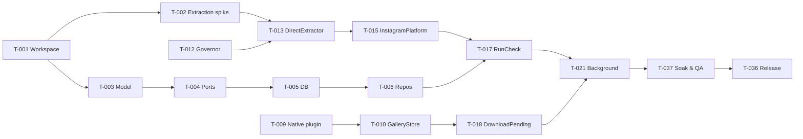

# Storize — Task Breakdown

> Status: **Draft v0.1 — awaiting review** · Owner: task-planner · Date: 2026-11-19 · Approved by: _pending_
> Based on: REQUIREMENTS v0.2, UX v0.2, TECH_SPEC v0.2 (all approved 2026-11-19).
> Tiers and routing: see `CLAUDE.md`. **v0.1a (2026-11-19):** Tier L implementation runs on Sonnet at the user's request; review stays on Opus. Status values: `todo`, `in_progress`, `in_review`, `changes_requested`, `blocked`, `done`.

## Summary
| Tier | Model | Agent | Count |
|------|-------|-------|-------|
| S | haiku | implementer-simple | 4 |
| M | sonnet | implementer-standard | 21 (+ 1 Could: T-035) |
| L | **sonnet** *(user decision; was opus)* | implementer-complex | 12 |
| **Total** | | | **37 Must/Should + 1 Could** |

Every task also goes through `test-engineer` (sonnet) and `code-reviewer` (**opus**) before it's marked `done`.
Task IDs show rough order, not strict order. Always follow the "Depends on" column (e.g. T-022 waits for T-025).
The dependency graph has been checked and has no cycles.

---

## 0. Prerequisites (owner: **user**) — these block implementation
| ID | What | Why | Blocks |
|----|------|-----|--------|
| P-1 | A **build environment**: either free ~17 GB on the PC (then the device shell starts; install Flutter stable + Android SDK 36 + JDK 17), **or** agree that agents push branches to GitHub and **GitHub Actions** is the only build/test runner | The Claude cloud workspace has no network for pub/Gradle, so code can't be compiled or tested there | All code tasks (local feedback); without either, nothing can be verified |
| P-2 | Give this session **push access to `Amr905/Storize`** (GitHub app/connector), and create the repo with a default branch `main` | Agents commit on branches and open PRs; CI runs on PRs | T-001 onwards |
| P-3 | A **dedicated Instagram test account**, following 2–3 consenting or own test accounts, which have at least: a photo story, a video story, a photo post, a video post, a carousel and a reel | The extraction spike and every adapter fixture | T-002 → T-013/T-014 |
| P-4 | **2 Android phones** for testing (ideally Samsung + Xiaomi/Oppo; one on Android 9 or lower if possible) | Background reliability, MediaStore on API ≤ 28 | T-009, T-021, T-037 |
| P-5 | A **release signing keystore**, created by you and kept offline; passwords added as GitHub Actions secrets | Signed releases (ADR-8) | T-036 |

---

## Milestones and critical path

**Critical path:** T-001 → T-002 (needs you and the test account) → T-013 → T-015 → T-017 → T-021 → T-037 → T-036.
The spike is the biggest schedule risk, so it starts first, in parallel with the foundation work.

| Milestone | Goal | Tasks |
|-----------|------|-------|
| **M0** Foundation & spike | Workspace builds in CI; extraction method documented | T-001…T-004 |
| **M1** Data & platform | DB, settings, session vault, gallery plugin, logging | T-005…T-011 |
| **M2** Instagram | Governor, both extractors, the platform adapter | T-012…T-015 |
| **M3** Domain | All use cases | T-016…T-020 |
| **M4** Background & system | Scheduler, dispatcher, notifications, update check | T-021…T-023 |
| **M5** UI | All screens S-01…S-15 | T-024…T-034 (+ T-035 Could) |
| **M6** Release & QA | Release pipeline, end-to-end tests, soak | T-036…T-038 |

### Parallel lanes (tasks in a lane can run alongside the other lanes)
- **Lane A (data):** T-005 → T-006, T-007, T-008, T-011
- **Lane B (native):** T-009 → T-010
- **Lane C (Instagram):** T-012 · T-002 → T-013 → T-014 → T-015
- **Lane D (UI kit):** T-024 → T-025 (can start once T-001 is done, using fakes from T-004)
- Screen tasks T-027…T-034 can run in parallel with each other once T-025 and their use cases exist.

---

## Task list

| ID | Title | Tier | Model | Depends on | Reqs | Status |
|----|-------|------|-------|------------|------|--------|
| T-001 | Workspace scaffold + CI | M | sonnet | P-2 | NFR-1, §10, §12 | todo |
| T-002 | Extraction spike: watch the real pages | L | sonnet | T-001, P-3 | FR-29, D-12 | todo |
| T-003 | `storize_model`: entities, enums, Result/Failure | S | haiku | T-001 | §4.3 | todo |
| T-004 | `storize_domain` ports + test fakes | M | sonnet | T-003 | §4.3, ADR-2 | todo |
| T-005 | drift schema v1 + DAOs + migration harness | L | sonnet | T-004 | §3, FR-13, FR-23, FR-65, FR-67 | todo |
| T-006 | Repository implementations (streams) | M | sonnet | T-005 | §2 | todo |
| T-007 | SettingsRepo (shared_preferences, allowed values) | S | haiku | T-004 | FR-50, BR-5, FR-64 | todo |
| T-008 | SessionVault (flutter_secure_storage) | L | sonnet | T-004 | FR-2, NFR-5, ADR-6 | todo |
| T-009 | Native plugin `storize_platform_android` | L | sonnet | T-001, P-4 | FR-33, BR-9, FR-51, ADR-11 | todo |
| T-010 | GalleryStore + MediaCache (Dart side) | M | sonnet | T-009, T-004 | FR-33, NFR-7, EC-20 | todo |
| T-011 | DiagnosticLog + redaction + crash hooks | M | sonnet | T-004 | §8, ADR-7 | todo |
| T-012 | RequestGovernor + `governor_lease` | L | sonnet | T-005 | NFR-4, BR-5, EC-15, ADR-9 | todo |
| T-013 | DirectExtractor + mappers (user, stories, posts, session) | L | sonnet | T-002, T-012 | FR-22…FR-24, FR-27, FR-28, FR-60…FR-62, FR-67 | todo |
| T-014 | PageExtractor (headless WebView fallback) | L | sonnet | T-013 | FR-29, EC-14 | todo |
| T-015 | InstagramPlatform: mode selection, failure map, openMedia | M | sonnet | T-013, T-014 | §4.1, §7 | todo |
| T-016 | Use case: AddTarget (validation, watermark) | M | sonnet | T-006, T-015 | FR-10…FR-16, FR-63, FR-65, FR-67, BR-1, BR-2, EC-16 | todo |
| T-017 | Use case: RunCheck (stories & posts) | L | sonnet | T-006, T-015, T-012 | FR-20, FR-21, FR-60, FR-64, FR-67, BR-7, EC-1…EC-7, EC-15 | todo |
| T-018 | Use case: DownloadPending | L | sonnet | T-010, T-006, T-015 | FR-22, FR-23, FR-25, FR-33, FR-61, NFR-7, NFR-13, EC-12, EC-13, EC-21 | todo |
| T-019 | Use cases: DeleteContent, RemoveTarget, ApplyRetention | M | sonnet | T-010, T-006 | FR-34, FR-14, FR-54, BR-4, BR-6, BR-9 | todo |
| T-020 | Use cases: DetectGaps, ComputeStorage, VerifySession | M | sonnet | T-006, T-015 | EC-10, EC-11, FR-53, FR-3, FR-4 | todo |
| T-021 | Scheduler + background dispatcher | L | sonnet | T-017, T-018, T-019, T-020, T-007 | FR-20, FR-21, FR-26, FR-64, NFR-2, ADR-4 | todo |
| T-022 | NotificationService (channels, grouping, deep links) | M | sonnet | T-021, T-025 | FR-40…FR-42, FR-66, EC-8 | todo |
| T-023 | UpdateChecker (GitHub Releases API) | S | haiku | T-006 | NFR-9, §4.2 | todo |
| T-024 | Design system: theme tokens + shared components + goldens | M | sonnet | T-001 | UX §5 | todo |
| T-025 | App shell: router, bottom nav, deep links, UiState pattern, l10n | M | sonnet | T-024, T-004 | UX §3, NFR-10 | todo |
| T-026 | Onboarding: S-01 risk, S-02 login + SessionCapture, S-03 setup | L | sonnet | T-025, T-008, T-009, T-020 | FR-1…FR-5, FR-51, BR-8 | todo |
| T-027 | Library S-04 (stories/posts) + filters S-05 + selection/delete | M | sonnet | T-025, T-019 | FR-30, FR-34, FR-35, BR-9 | todo |
| T-028 | Story viewer S-06 | M | sonnet | T-027 | FR-31, FR-32, FR-24, EC-20 | todo |
| T-029 | Post viewer S-15 | M | sonnet | T-027 | FR-31, FR-32, FR-61, FR-62, EC-20, EC-21 | todo |
| T-030 | Targets S-07 + Add target S-08 | M | sonnet | T-025, T-016, T-021 | FR-10…FR-16, FR-21, FR-65, FR-67 | todo |
| T-031 | Target detail S-09 + Remove dialog S-10 | M | sonnet | T-030, T-019 | FR-14, FR-15, FR-16, FR-53, BR-6 | todo |
| T-032 | Activity S-11 | M | sonnet | T-025, T-020 | FR-52, EC-7, EC-10, EC-14, EC-15 | todo |
| T-033 | Settings S-12 + Instagram account S-13 | M | sonnet | T-025, T-021, T-020, T-023 | FR-50, FR-53, FR-54, FR-4, FR-42, BR-7 | todo |
| T-034 | App lock S-14 + PIN setup + lock gate | L | sonnet | T-025, T-008 | A-4, NFR-5, UQ-2 | todo |
| T-035 | *(Could)* ExportZip | M | sonnet | T-031 | FR-36 | todo |
| T-036 | Release pipeline (`release.yml`) + README install guide | M | sonnet | T-001, P-5 | ADR-8, NFR-9 | todo |
| T-037 | End-to-end tests + device soak checklist | M | sonnet | T-021…T-034 | NFR-2, NFR-3, NFR-12 | todo |
| T-038 | Accessibility & RTL pass + string audit | S | haiku | T-026…T-034 | NFR-10, NFR-11 | todo |

---

## Task details

### T-001 — Workspace scaffold + CI
- **Tier:** M · **Files:** repo root (`pubspec.yaml` workspace, `melos.yaml`, `analysis_options.yaml`), `app/` (flavors dev/prod, minSdk 26,
  target 36, `allowBackup=false`, no cleartext), `packages/*` skeletons (5), `.github/workflows/ci.yml`, `.gitignore`;
  remove the root `src/` and `tests/` placeholders.
- **Spec:** TECH_SPEC §0, §10, §12, §13.
- **Acceptance criteria:**
  1. `flutter pub get`, `flutter analyze` and `melos run test` pass on a clean checkout (an empty test per package).
  2. Dependency rules hold: `storize_model` and `storize_domain` have no Flutter dependency.
  3. `cd app && flutter build apk --debug --flavor dev` succeeds in CI.
  4. CI on PR runs format check, analyze, tests and **gitleaks**, and fails on any of them.
  5. Melos scripts exist: `gen`, `test`, `golden:update`.

### T-002 — Extraction spike: watch the real pages
- **Tier:** L (risk + ambiguity) · **Owner:** implementer-complex + **user** (logs in with the P-3 test account and runs the capture steps the agent writes).
- **Files:** `docs/03-specs/INSTAGRAM_EXTRACTION.md`, `packages/storize_instagram/test/fixtures/**` (sanitized),
  `tool/sanitize_fixture.dart`, and a debug-only WebView inspector screen in `app/lib/debug/`.
- **Spec:** TECH_SPEC §4.1 steps 1–6, ADR-3.
- **Acceptance criteria:**
  1. For the story page, profile page and post page (photo, video, carousel, reel), the doc lists the request(s) that carry the
     media links: method, URL pattern, required headers/cookies, and the response fields used. IG-1…IG-5 are each marked confirmed, replaced or missing.
  2. A plain GET of a story-image CDN URL and a video CDN URL downloads the file without cookies (recorded result).
  3. The doc records whether videos are progressive MP4 or DASH-only.
  4. The page-mode hook (fetch/XHR wrap) captures the same JSON in the debug WebView (proof logged).
  5. Whether `HeadlessInAppWebView` runs in a workmanager background isolate on both P-4 phones (yes/no + notes) → sets the default for AQ-6.
  6. Fixtures pass the sanitizer (no `sessionid`/`csrftoken`/`ds_user_id`, no signed query params, only test-account content); gitleaks is clean.
- **Notes:** if a candidate endpoint no longer exists, propose the replacement in the doc. Port changes need Lead approval.

### T-003 — `storize_model`
- **Tier:** S · **Files:** `packages/storize_model/lib/**`.
- **Spec:** §4.3 (Result, Failure subclasses, RemoteUser, RemoteContent, RemoteMedia, enums ContentKind/PostType/MediaType/
  TargetStatus/AccountStatus/Category/CheckScope/ExtractionPolicy).
- **AC:**
  1. All types are immutable with `==`/`hashCode`.
  2. 100% of the sealed classes are exhaustively switchable.
  3. Unit tests cover equality.
  4. Pure Dart.

### T-004 — `storize_domain` ports + fakes
- **Tier:** M · **Files:** `packages/storize_domain/lib/ports/**`, `test/fakes/**`.
- **Spec:** §4.3 (ContentPlatform, GalleryStore, SessionStore, Scheduler, repo interfaces, Clock).
- **AC:**
  1. All ports are defined with dartdoc.
  2. In-memory fakes exist for every port, usable by other packages' tests (exported from a `testing.dart` library).
  3. No Flutter imports.

### T-005 — drift schema v1 + DAOs + migration harness
- **Tier:** L (data model) · **Files:** `packages/storize_data/lib/db/**`, `drift_schemas/`, tests.
- **Spec:** §3 (all tables including `governor_lease`, constraints, indexes).
- **AC:**
  1. Every table, column, UNIQUE/CHECK constraint, FK action and index matches §3. That includes `track_reels`, the CHECK that
     at least one track flag is on, and `posts_watermark_at NOT NULL`.
  2. Tests prove: a duplicate target is rejected (EC-16); a duplicate content is rejected (BR-3); deleting a target cascades
     content and media_file; deleting a login account sets `target.login_account_id` to null.
  3. A schema dump is committed and the migration test harness is set up (v1 baseline).
  4. Queries needed by the Library (kind + target + date range + media type, newest first) use the indexes (EXPLAIN check in test).

### T-006 — Repository implementations
- **Tier:** M · **Files:** `packages/storize_data/lib/repo/**`.
- **AC:**
  1. Every repo port from T-004 is implemented over drift.
  2. Streams emit on change.
  3. Tests use an in-memory DB.
  4. Activity pruning helper (older than 7 days).

### T-007 — SettingsRepo
- **Tier:** S · **Files:** `packages/storize_data/lib/settings/**`.
- **AC:**
  1. Keys and defaults exactly as §3 "Settings".
  2. Setters reject values outside the allowed sets (e.g. story interval 10 → error; post interval 30 → error).
  3. Stream of changes.
  4. Tests.

### T-008 — SessionVault
- **Tier:** L (security) · **Files:** `packages/storize_data/lib/security/**`.
- **AC:**
  1. Save, load and clear the session blob (cookies, UA, capturedAt) through flutter_secure_storage.
  2. A decryption or read failure returns null and marks the account `LOGGED_OUT` (ADR-6).
  3. The blob's `toString` is redacted.
  4. Works from a background isolate (test or doc note).
  5. Tests with a fake storage backend.

### T-009 — Native plugin `storize_platform_android`
- **Tier:** L · **Files:** `packages/storize_platform_android/**` (Kotlin + Dart API).
- **Spec:** ADR-11, §3 Files.
- **AC:**
  1. `insert` writes into `Pictures/Storize/<dir>/` with IS_PENDING on API 29+, or a direct write + MediaScanner on API ≤ 28,
     and returns `{uri, size}`. The file shows up in the Gallery app (manual check, P-4).
  2. `delete(uri)` removes an app-owned file with no system prompt on API 29+.
  3. `exists`, `size`, `videoThumbnail` (webp) work.
  4. `openBatterySettings(oem)` opens the best matching screen or falls back to app details; `isIgnoringBatteryOptimizations` works.
  5. *(amended 2026-11-19, Lead)* `lastStopReasons()` returns process-exit reasons via `ApplicationExitInfo` on API 30+ (empty below), avoiding a `work-runtime` dependency. Per-worker `WorkInfo.stopReason` is out of scope; T-021 logs worker outcomes itself.
  6. *(amended 2026-11-19, Lead)* Kotlin JVM unit tests run in CI (`:storize_platform_android:testDebugUnitTest`). Instrumentation tests are written for API 28, 29 and 34+ and are run by the user on their phone (P-4).
  7. Plugin channels aren't reachable from other apps.

### T-010 — GalleryStore + MediaCache
- **Tier:** M · **Files:** `packages/storize_data/lib/files/**`.
- **AC:**
  1. Implements the `GalleryStore` port over T-009.
  2. Display names follow `<username>_<yyyyMMdd_HHmmss>_<remoteId>[_<slide>].<ext>`, and names are sanitized.
  3. `.part` files live in the cache; leftover parts are cleaned on start.
  4. Thumbnails are written to `files/thumbs`.
  5. Tests with a fake channel.

### T-011 — DiagnosticLog
- **Tier:** M · **Files:** `packages/storize_data/lib/log/**`, crash hooks in `app/lib/main*.dart`.
- **AC:**
  1. Rotating file 3 × 1 MB.
  2. Redaction unit tests for every pattern in §8 (cookies, tokens, signed URL params, PIN).
  3. `FlutterError.onError`, `PlatformDispatcher.onError` and the background zone all write to the log.
  4. Crashes create an `APP_CRASH` activity on the next start.

### T-012 — RequestGovernor + lease
- **Tier:** L · **Files:** `packages/storize_instagram/lib/governor/**`, uses the `governor_lease` DAO.
- **Spec:** ADR-9.
- **AC:**
  1. Token bucket 60/h, burst 6; page-mode loads cost 3.
  2. Jitter of 1.5–6 s between calls.
  3. One call in flight per account across isolates (a lease with a 10-min expiry).
  4. `RateLimited` → pause `retryAfter` or 15 min and ×2 the interval multiplier for 2 h; a repeat within 24 h → ×4.
  5. Limits are config values.
  6. `fake_async` tests for all of the above.

### T-013 — DirectExtractor + mappers
- **Tier:** L · **Files:** `packages/storize_instagram/lib/direct/**`, `lib/mapper/**`.
- **Spec:** INSTAGRAM_EXTRACTION.md (from T-002), §4.1 failure map.
- **AC:**
  1. Implements resolveUser, refreshUser, fetchStories (chunks ≤ 20), fetchNewPosts (watermark), latestPostTime and verifySession, as
     the spike documented. Every call goes through the governor.
  2. Mapping covers: photo, video, carousel (ordered slides), reel (`post_type REEL`), close friends, link stickers, captions,
     shortcode. Live items are dropped (FR-28).
  3. Best-quality selection rule (§4.1). DASH-only → `FAILED(unsupported_stream)`.
  4. Each row of the failure map has a fixture test.
  5. Missing fields → `SchemaChanged(where)`.
  6. The WebView User-Agent and session headers are applied; nothing sensitive is logged.
  7. *(Added 2026-11-20 from T-002.)* Step 0, live probe on the user's phone (P-4) through `RequestGovernor`: try IG-1…IG-5 once each and record only status + top-level key names; plus T-002 AC2 (story image/video plain GET) and AC4 (phone hook check). Direct mode is REST where the probe proves it; otherwise those calls use the GraphQL patterns in INSTAGRAM_EXTRACTION.md (doc_id discovered at runtime, never hard-coded).
  8. *(From T-002.)* Images from the timeline/story responses (media/info is capped at 720 px); pinned posts are not "newest"; collab posts (`coauthor_producers`) count for the tracked user; non-fatal `errors[]` next to complete data is not `SchemaChanged`.

### T-014 — PageExtractor
- **Tier:** L · **Files:** `packages/storize_instagram/lib/page/**`, `assets/hook.js`.
- **AC:**
  1. HeadlessInAppWebView with the session cookies; loads story, profile and post URLs.
  2. The UserScript hook captures the spike's JSON patterns; DOM `img`/`video` reading is the last resort.
  3. Same mapper as T-013.
  4. 20-second timeout → `SchemaChanged`.
  5. Cookies and WebView data are cleared after each run.
  6. The JS handler only accepts messages from instagram.com origins.
  7. Parser tests on saved HTML/JSON fixtures.
  8. Background use is gated by `pageModeInBackground`.
  9. *(Moved from T-002 AC5.)* On-device test: HeadlessInAppWebView runs inside the workmanager background isolate on two phones (P-4).
  10. *(From T-002.)* Opening a story in the page fires `PolarisStoriesV3SeenMutation` (marks it seen). Behaviour per user decision UD-3.

### T-015 — InstagramPlatform
- **Tier:** M · **Files:** `packages/storize_instagram/lib/instagram_platform.dart`, `lib/media/**`.
- **AC:**
  1. Implements `ContentPlatform`.
  2. `directThenPage` policy → page mode only after `SchemaChanged`.
  3. `openMedia` streams with `Range` resume and no cookies; 403 → `ExpiredUrl` signal so the caller can refresh.
  4. Logs `PAGE_MODE_USED`.
  5. Tests with fake extractors.

### T-016 — AddTarget
- **Tier:** M · **Files:** `packages/storize_domain/lib/usecases/add_target.dart` + tests.
- **AC:**
  1. Input normalization (`name`, `@name`, `instagram.com/name` with any scheme, `www` or trailing path); regex rules from UX S-08.
  2. Each outcome in §4.3 is returned correctly, with a test per outcome.
  3. A category is required; at least one track flag (Stories/Posts/Reels).
  4. Sets `posts_watermark_at` from `latestPostTime` (or now).
  5. The over-50 warning flag.
  6. Triggers a first check via the Scheduler port.

### T-017 — RunCheck
- **Tier:** L · **Files:** `usecases/run_check.dart` + tests.
- **AC:**
  1. Scopes STORIES and POSTS. Only targets with the matching track flag, and only ACTIVE (paused ones are skipped).
  2. BR-7: if the session isn't ACTIVE → `SKIPPED_SESSION`, no calls.
  3. Stories: batched ≤ 20, diffed by remote_id. Posts: watermark + unique key; reels filtered by `track_reels`, other types by
     `track_posts` (FR-67); the watermark advances after success.
  4. Target status updates for EC-3/EC-4/EC-5/EC-6, and username refresh.
  5. Round-robin carry-over when the governor budget runs out (ADR-9).
  6. Writes `check_run` (scope, mode) and activity events.
  7. A single target's failure never aborts the run.
  8. Tests for every BR/EC listed.

### T-018 — DownloadPending
- **Tier:** L · **Files:** `usecases/download_pending.dart` + tests.
- **AC:**
  1. Processes PENDING media_files until the deadline (about 8 min), then returns `remaining`.
  2. Streams to `.part` with `Range` resume, then inserts into the gallery under the **current** username folder.
  3. 403 → refresh the URL once via the platform.
  4. 5 attempts → FAILED; a post with some failed slides → `PARTIAL` (EC-21).
  5. An item gone remotely → `REMOVED_BEFORE_DOWNLOAD` (EC-7).
  6. Free space under 1 GB → `STORAGE_LOW` event; under 200 MB → stop + `STORAGE_PAUSED` (NFR-13).
  7. Returns new counts per target and kind for notifications (EC-8).
  8. Kill-safety test: no orphan DB rows and no half files (NFR-7).

### T-019 — DeleteContent, RemoveTarget, ApplyRetention
- **Tier:** M · **AC:**
  1. Gallery file first, then DB rows (BR-9); a missing file is ignored.
  2. RemoveTarget with keep or delete media (BR-6).
  3. Retention deletes content older than N days, including gallery files.
  4. Nothing is deleted because of remote expiry (BR-4).
  5. Tests.

### T-020 — DetectGaps, ComputeStorage, VerifySession
- **Tier:** M · **AC:**
  1. Gap rule from §4.3; one `GAP` event per gap.
  2. Storage totals per target (size_bytes sum) and the device's free space.
  3. VerifySession maps to account statuses (FR-3/FR-4).
  4. Tests.

### T-021 — Scheduler + background dispatcher
- **Tier:** L · **Files:** `app/lib/background/**`, `packages/storize_data/lib/scheduler/**`.
- **AC:**
  1. `apply()` registers or replaces `check-stories` (≥ 15 min) and `check-posts` (≥ 60 min, offset start), plus `retention` and
     `update-check`, with constraints (network; unmetered if Wi-Fi only).
  2. `checkNow(scope, target?)` enqueues an expedited one-off.
  3. The dispatcher builds a minimal container in the background isolate and routes each task to its use case;
     download rolls over to a one-off `download` task.
  4. Gap detection runs at each start.
  5. Works after a reboot and after the app is force-stopped and reopened (manual test on both P-4 phones, recorded in the review).
  6. Routing unit tests.

### T-022 — NotificationService
- **Tier:** M · **AC:**
  1. Channels as in §4.3.
  2. Grouped notifications for stories and posts, one per target plus a summary (EC-8).
  3. Login and storage alerts.
  4. Tap → deep links (S-06, S-15, S-13, S-04, S-12).
  5. Respects the notify toggles (FR-42).
  6. POST_NOTIFICATIONS permission handling.

### T-023 — UpdateChecker
- **Tier:** S · **AC:**
  1. Calls `GET https://api.github.com/repos/Amr905/Storize/releases/latest`, parses `tag_name`, `html_url` and the body lines `min-supported:` / `sha256:`.
  2. Exposes `UpdateState` (none / available / required).
  3. Silent on errors.
  4. Tests with a mocked dio.

### T-024 — Design system
- **Tier:** M · **Files:** `app/lib/ui/theme/**`, `app/lib/ui/components/**`.
- **Spec:** UX §5 tokens (light and dark), type scale, shapes, and the 16 listed components.
- **AC:**
  1. Every component exists with the variants listed in UX §5.3.
  2. Golden tests in light and dark.
  3. Directional padding only (RTL-ready).
  4. 48-dp touch targets.

### T-025 — App shell
- **Tier:** M · **AC:**
  1. go_router with the routes and deep links from §4.3.
  2. Bottom nav with 4 tabs and a separate back stack for each.
  3. `UiState` pattern + SessionBanner wiring.
  4. ARB localization setup (English).
  5. Onboarding and lock gates are routing hooks only (implemented in T-026/T-034).

### T-026 — Onboarding + login
- **Tier:** L (security) · **Spec:** UX S-01…S-03, TECH_SPEC §5.1.
- **AC:**
  1. S-01: Continue is disabled until the checkbox is ticked; `riskAcknowledgedAt` is stored.
  2. S-02: login WebView with the host allowlist and no JS handlers. Success is detected via cookies, then IG-4 confirms it,
     the session goes to the vault, and **the WebView's cookies and storage are cleared**.
  3. The re-login account-switch confirmation.
  4. Error states per UX.
  5. S-03: notification and battery steps re-check on resume; manufacturer-specific steps; the Android 8–9 storage card.
  6. Goldens match the mockups.

### T-027 — Library + filters
- **Tier:** M · **AC:**
  1. Stories/Posts switch with unviewed counts.
  2. Stories tiles 9:16, post tiles square with a carousel badge; duration and new-ring badges.
  3. Account chips, filter sheet (accounts, kind, date, type).
  4. Selection mode with delete (gallery wording) and share.
  5. Pull-to-refresh → check now.
  6. The 3 empty states plus loading and error.
  7. 5,000 items open in under 1 s (performance test, NFR-12).

### T-028 — Story viewer S-06
- **Tier:** M · **AC:**
  1. Swipe through a target's stories; position bars.
  2. Video playback, mute, scrubber.
  3. Link-sticker strip; Info sheet including the gallery folder.
  4. Share and Delete; **no Save button**.
  5. Missing-file state (EC-20).
  6. Marks items viewed.

### T-029 — Post viewer S-15
- **Tier:** M · **AC:**
  1. Slide pager with dots and counter; photo zoom; video controls.
  2. Type label (Photo / Video / Carousel / Reel).
  3. Expandable caption.
  4. Info with a copyable post link.
  5. Share this slide or all slides.
  6. Delete the whole post with gallery wording.
  7. Per-slide missing or not-downloaded states.

### T-030 — Targets + Add target
- **Tier:** M · **AC:**
  1. S-07 list with status badges, category tags and meta lines; Check now is disabled when the session isn't active.
  2. Rate-limit bar; swipe to pause or resume.
  3. S-08 form with every validation rule in UX, the Track chips (Stories/Posts/Reels, at least one) and the backfill hint.
  4. Verifying and error states.
  5. Over-50 warning.

### T-031 — Target detail + Remove
- **Tier:** M · **AC:**
  1. Header, status explanation card, editable category and note.
  2. Track toggles (at least one).
  3. Stats for stories, posts and space.
  4. Check now and Pause/Resume; a Recent switch between stories and posts.
  5. Overflow menu: Export (if T-035 is done) and Remove.
  6. S-10 dialog with keep (default) or delete-with-gallery wording.

### T-032 — Activity S-11
- **Tier:** M · **AC:**
  1. All entry types from §3 with the correct tone and icon.
  2. Filter chips (All / Downloads / Errors / Gaps).
  3. Actions: a gap opens S-03, a session entry opens S-13, a download opens its viewer.
  4. 7-day window.

### T-033 — Settings + Instagram account
- **Tier:** M · **AC:**
  1. Every S-12 row, with the allowed interval sets and the 1-hour post-interval warning.
  2. Wi-Fi only, notification toggles (including New posts), the storage info row, per-account usage, retention with its
     confirmation, and the app-lock row note "gallery files are not locked".
  3. S-13 health states and actions; log out keeps targets and downloads.
  4. The update-available row (from T-023).

### T-034 — App lock
- **Tier:** L (security) · **AC:**
  1. Enable with biometric or a PIN entered twice that matches (4–6 digits).
  2. PIN stored as a PBKDF2 hash (210k iterations, salt).
  3. 5 wrong PINs → 30-second cooldown.
  4. Re-locks after 60 s in the background.
  5. Turning it off requires authentication.
  6. The lock gate covers deep links too.

### T-035 — *(Could)* ExportZip
- **Tier:** M · **AC:**
  1. ZIP of a target's files, built by a background task with a progress notification.
  2. Share or save the result.
  3. Cancelable.
  4. Skip this if time is short.

### T-036 — Release pipeline
- **Tier:** M · **Files:** `.github/workflows/release.yml`, `README.md`.
- **AC:**
  1. Tag `v*` → signed `prod` APK (secrets from P-5), obfuscated, with symbols kept as a build artifact.
  2. A GitHub Release with the APK and a body containing `sha256:` and `min-supported:`.
  3. README: install steps (unknown apps), the dedicated-account warning, the risks, and how to update.
  4. Nothing secret is in the repo (gitleaks).

### T-037 — End-to-end tests + soak
- **Tier:** M · **AC:**
  1. `integration_test` flows: onboarding with a fake platform, add target, a check producing a story and a post, the Library
     showing them, delete.
  2. A soak checklist executed on both P-4 phones for 24 h with about 20 test targets: missed stories, gaps and battery % recorded (NFR-2/NFR-3).
  3. A results report in `docs/05-reviews/SOAK.md`.

### T-038 — Accessibility & RTL pass
- **Tier:** S · **AC:**
  1. Every icon-only control has a semantics label.
  2. No hard-coded strings (lint check).
  3. RTL smoke test with a pseudo-locale renders correctly.
  4. Font scale 200% shows no clipped status text on S-04, S-07 and S-09.

---

## Coverage (Must requirements → tasks)
| Requirement | Tasks |
|-------------|-------|
| FR-1…FR-5 | T-008, T-020, T-026, T-033 |
| FR-10…FR-16 | T-005, T-016, T-030, T-031 |
| FR-20, FR-21 | T-017, T-021, T-027, T-030 |
| FR-22…FR-25, FR-27, FR-28 | T-013, T-015, T-018 |
| FR-26 | T-021, T-033 |
| FR-29 | T-002, T-013, T-014, T-015 |
| FR-30…FR-35 | T-027, T-028, T-029, T-010 |
| FR-36 (C) | T-035 |
| FR-40…FR-42 | T-022, T-033 |
| FR-50…FR-54 | T-007, T-009, T-011, T-019, T-020, T-026, T-032, T-033 |
| FR-60…FR-67 | T-005, T-013, T-016, T-017, T-018, T-022, T-029, T-030, T-031, T-033 |
| BR-1…BR-9 | T-016, T-017, T-019, T-021, T-026 |
| EC-1…EC-22 | T-005, T-013, T-016…T-020, T-027…T-032 |
| NFR-1…NFR-13 | T-001, T-008, T-011, T-012, T-018, T-021, T-024, T-027, T-037, T-038 |

## Open points for the Lead / user
- **P-1 decides how agents verify code.** Without local Flutter, every check runs in GitHub Actions. That's slower but works.
- **T-002 needs you in the loop** (test account login, a short capture session on your PC or phone). The agent prepares the exact steps.

---

## v0.3 tasks (2026-11-24)

### T-039 — Add never hangs; today's content on add
- **Tier:** M · **Deps:** — · TECH_SPEC §17.3–17.4
- **AC:**
  1. `RequestGovernor.run` takes `maxWait`. Over it, the call returns `RateLimited(retryAfter)` without waiting.
  2. The S-08 add, S-02 verify and Check now resolve use 8 s. S-08 shows "Instagram limit reached — try again in N min" and never spins for more than about 10 s.
  3. AddTarget sets the post watermark to the start of today and doesn't call `latestPostTime`.
  4. Tests for the over-wait return, the UI message and the today watermark.

### T-040 — History & highlights: model, domain, data, background
- **Tier:** L · **Deps:** T-039 · TECH_SPEC §17.1–17.3
- **AC:**
  1. Model types, the ports (with fakes) and a drift migration with tests.
  2. `BackfillHistory.step` and `SyncHighlights.run` as specified, with resume after a rate limit or restart, no duplicates, respecting the toggles.
  3. A background `history` task after checks, and highlight sync on the post interval.
  4. Gallery path for highlights.
  5. `InstagramPlatform` gets stubs that return `UnknownFailure('not_implemented')` until T-041.

### T-041 — Instagram: post pages & highlights
- **Tier:** L · **Deps:** T-040 · ADR-0003
- **AC:**
  1. `fetchPostPage` uses direct GraphQL with the discovered timeline query and `after` cursor, with page mode (profile load plus scroll, hook-captured connection responses) as the fallback.
  2. `fetchHighlights` comes from the profile's highlights tray response.
  3. `fetchHighlightItems` comes from the reels media query with `highlight:<id>` reel ids, or the highlight page in page mode with the seen mutation blocked.
  4. Everything goes through the governor and lease.
  5. Sanitized synthetic fixtures; real captures to follow on device (DEVICE_TESTS).

### T-046 — Queued add: add now, look up later (FR-73)
- **Tier:** M · **Deps:** T-042 · TECH_SPEC §17.3a
- **AC:**
  1. `AddTarget` saves a pending target on `RateLimited` (incl. governor pause) or `NetworkFailure`, keeps the chosen options, rejects duplicates by username and still fails inline on not found, private and session errors.
  2. `ResolvePendingTargets.run` activates, marks unavailable or not visible, merges duplicates by user ID, or stops and leaves the rest pending when limited.
  3. It runs first in each story and post check task and on app resume; checks, history and highlights skip pending targets.
  4. S-08 shows the "Added. Instagram asked us to slow down…" snackbar; S-07 and S-09 show a "Waiting to look up" chip.

### T-042 — UI: history picker, progress, highlights
- **Tier:** M · **Deps:** T-040 · UX additions in §17
- **AC:**
  1. S-08 gets a "Post history" picker (None / Today / 7 days / 30 days / Since date / All) and a Highlights toggle.
  2. S-09 shows history progress with Pause/Resume/Cancel, plus the range and Highlights toggle editors.
  3. The Library gets a Highlights filter, and S-06 shows the highlight title.
  4. Goldens are made under TZ=UTC.

### T-052 — Profile preview and manual save (FR-74)
- **Tier:** L · **Deps:** T-050 · TECH_SPEC §17.4b
- **Scope:** `PreviewProfile`, `SavePreviewItems`, `DownloadPending(onlyContentIds)`, preview screen (S-08 "Preview", S-09 "Preview & save"), in-page query logs and the background-reserve stall fix.
- **AC:**
  1. The preview loads profile, current stories and the first posts page in one in-page session, which is closed at the end; a failure in one part keeps the other.
  2. The user can select items, "Save selected (n)" or "Save all"; files go to `Pictures/Storize/<user>/` only through `GalleryStore`; saved items show a check badge; repeats are "already saved".
  3. Saving from an untracked account creates a paused preview-only target; nothing downloads automatically. "Track this account automatically" opens the add form with the username, or activates that target.
  4. Every in-page query logs `start` and an end line with ms; no values in logs.
  5. Goldens (light and dark) under TZ=UTC.
